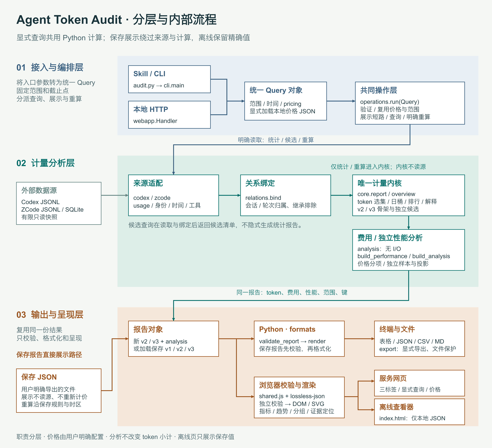

# 图设计：用量、费用与独立性能三层架构

[原尺寸 PNG（3600 × 3280）](./architecture.png) · [可编辑 PPTD 图源](./architecture.pptd)

- 目标：看清三个入口如何共用读取、token 计量和费用/独立性能分析，以及保存展示如何绕过来源与计算。三层是源码职责分组，不表示独立部署。
- 结构：沿用上下三层泳道、层内从左到右，费用/性能节点续接 token 内核的报告骨架与独立候选；连接由共同操作层编排，不表示 core 直接调用 analysis。外部来源和保存 JSON 仍单列。
- 接入：Skill/CLI 和 HTTP 汇入 Query；显式本地价格转成 pricing，operations 验证或复用保存快照，固定身份/范围/截止点。候选查询在读取/绑定后返回，不进入计量与分析。
- 计算：只读来源 → codex/zcode 适配 → relations.bind → core.report/overview → analysis.build_performance/build_analysis → 同一 v2/v3。analysis 无 I/O，费用按明确配置、性能按独立样本计算，不改变 token 小计。
- 消费：同一报告分别由 formats 与 shared.js/lossless-json 校验、输出或呈现；双环境独立校验保留。服务页提供三标签和显式查询，离线页只消费保存 JSON。
- 保存旁路：JSON 直接进入输出层，不读源、不重新计价；只有明确重算/更新经 operations 回源，默认沿保存规则与时区。箭头展示主要处理/消费关系，不展开全部函数调用。
- 视觉：沿用蓝灰、青绿、赭色和 Arial / Hiragino Sans GB，1800 × 1640 画布、2 倍 PNG；原节点与保存旁路不重排为新机制。仅加一个分析节点并延长泳道，为正文和连线保留空间。
- 导出：当前无 kimi-slides CLI，复用工作区外临时 Canvas 解释器按本图已有 PPTD 字段确定性栅格化；未增加产品依赖，未验证官方渲染引擎或 PPTX 导出。

## Karpathy 精简与自检

- 基线：核对合并后的实现合同、architecture.md 及 operations.run/run_overview/_performance_extension、analysis.build_performance/build_analysis、formats/check_analysis 和 shared.js 保存校验；三入口接线和保存旁路均有对应源码。
- 假设与差异：层内箭头表达处理/消费顺序，实际分析由操作层接线；没有产品行为变化，没有让离线页获得回源能力。
- 最小方案：复用原三层泳道和原图源，只增一个分析节点及其连接。仅改内核文字会误示计价与性能属于 token 内核，改成新布局则没有新增表达收益。
- 删除审计：更新旧图中“内核直接生成完整报告”的说明，保留骨架/候选、实际模块、独立校验、保存旁路和只读依赖；不加入未实现采集、默认价格或远程服务。
- 直接验收：最终 PNG 已视觉核对；81 个可编辑元素、16 个流程节点、17 条线，三层内部节点为 4/4/6。机械检查画布边界、文字溢出、连线穿字、连接端点、保存旁路、主题引用及 PNG 与源一致性；图示不代替产品真实验收。
