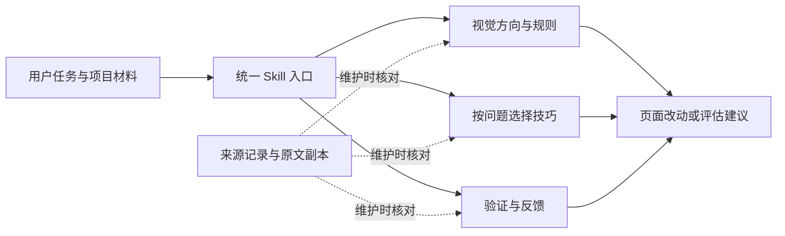

# 前端美化 Skill 与工作流模块设计

| 元数据 | 内容 |
| --- | --- |
| 文档版本 | V0.2（设计文档版本，不是产品发布版本） |
| 文档状态 | 待评审 |
| 创建日期 | 2026-10-16 |
| 修订日期 | 2026-10-16 |
| 适用范围 | `frontend-design-workflow` 模块及其同名 Agent Skill |
| 批准状态 | 需求 V0.1 已获批；用户新增使用反馈能力并选定工作区外统一持久保存，需求 V0.2 与本文的具体规则待审阅 |
| Agent triage 状态 | `ready-for-human` |
| 对应需求 | [前端美化 Skill 与工作流模块需求](./2026-10-15-frontend-design-workflow-requirements.md) V0.2 |
| 当前交付范围 | 同步新增反馈能力的需求与设计；不创建实现、执行计划、经验目录或安装副本 |

## 1. 问题与设计基线

### 1.1 要解决的问题

用户已经搜集了多套前端美化素材，希望模型能用它们改善实际页面。但直接把全部 Skill 放在一起，会让模型面对重复流程、相互冲突的风格要求，以及尚未确认的工具依赖。只留下几句通用建议，又会丢掉素材中的具体技巧和例子。

本设计要解决的是：用一个入口组织这些方法，让模型知道何时用什么、如何适配当前页面、怎样验证结果；同时让维护者能回查来源、保留未证实的经验并比较外部更新。四类前端任务和六个工作环节沿用已批准需求。

V0.2 增加使用反馈：每次任务保留优化经验、能力缺口、外部补充、实际使用情况和流程问题，后续通过同一入口回顾这些记录，形成改进建议。这样维护者可以根据实际使用调整 Skill，而不只依靠原始素材或零散印象。

### 1.2 已有事实对设计的约束

V0.1 设计时已读取权威需求、仓库协作与规格约定、相关模块的实际 Skill，以及脱离源码目录运行的测试。V0.2 修订前重新核对需求、现有设计、工作区及协作规则：本模块仍只有两份规格，没有实现、专用术语表或 ADR。

| 已核对的基线 | 对本方案的影响 |
| --- | --- |
| [analyzing-projects](../../analyzing-projects/README.md) 通过一个 [Skill 入口](../../analyzing-projects/skills/analyzing-projects/SKILL.md)引用条件性参考，模块说明留在外层 | 复用这种纯文档模块结构；不需要运行服务或新的调度器 |
| [online-media-reader](../../online-media-reader/README.md) 将入口和执行所需资源整体分发；[现有安装测试](../../online-media-reader/tests/test_online_media_reader_installer.py)检查移除来源后仍能启动 | 复用完整分发和脱离源码验收的边界；不复用与本任务无关的安装器实现 |
| 本地两个技能包的主要模板相同，入口仍包含生成产品说明、指定技术栈和多套方案等动作 | 共用整理后的方法，分别保留来源；这些动作按当前任务需要使用，不成为每次美化的固定前置步骤 |
| 需求已批准四类任务、六个环节、三份主要参考资料和 A1–A7 验收条件 | 设计细化进入条件、资料职责和通过证据，不缩减场景或改动验收强度 |
| 外部条目既有可直接阅读的方法，也有要求其他文件、脚本或平台能力的入口 | “参考方法”和“执行外部工具”分开；不能由入口存在推导工具可运行 |
| 用户允许保留不确定经验，仓库要求实际任务有直接验收证据 | 技巧效果可以待验证；当次已实施页面的必要检查仍须完成 |
| V0.1 只允许在交付或指定位置记录候选技巧效果，未定义跨任务使用情况、能力缺口和汇总方式 | 原反馈规则集中扩展，保留证据边界；以简短任务记录补足新需求，不另建数据服务 |
| 用户要求持续沉淀，并选择工作区外统一持久目录；本仓库的临时评估产物有专门位置约束 | 长期经验与临时证据分开，实际写入遵守授权；无法持久保存时明确报告缺口 |
| [项目协作规则](../../AGENTS.md)要求分阶段批准，使用[本地规格工作流](../../docs/agents/issue-tracker.md) | 本文发布到模块规格目录；设计批准前不编写执行计划，不以标签代替批准 |

### 1.3 已知信息与假设

目标模型能够读文件和理解自然语言。读图、浏览器、命令执行等能力由使用环境提供，Skill 不自行补齐这些能力。初版采用普通 Markdown 内容，不引入脚本或必装的外部 Skill；这不限制使用者利用目标项目已有工具。

使用反馈由当前模型根据可观察的任务过程整理，属于本地记录能力，不是后台遥测。默认在任务收尾保存一份简短记录；回顾和修改 Skill 仍由相应维护请求触发。默认记录时机、文件组织及统计口径是本次新增的设计决策，随 V0.2 待批准，不追认为 V0.1 已批准内容。

远程素材目前是网页阅读基线，尚未取得完整的固定 commit 快照，也未逐项读完 taste 的所有正文、资源和许可。因此，下文区分“纳入整理范围”与“已经可以复制分发”。正式引入前必须完成相应核对，不能把本次设计中的候选表作为已完成引入的证明。

## 2. 解决方案

### 2.1 用户如何使用

用户向模型提出页面任务，并直接指向仓库中的 Skill，或使用已经完整复制的 Skill。模型先明确目标、允许的动作和现有约束，再按问题读取所需资料。已有视觉规范可以直接沿用；参考截图用于提取可见关系；选出的技巧需要在代表页面上检查，再推广到其他受影响位置。

例如，用户要求“保留品牌和功能，让订单列表更清晰”，模型应检查当前列表和相关组件，选择改善分组、文字层级或操作主次的方法，检查长订单名、空列表与关键操作，最后给出前后变化及未验证项。这个请求不需要重新生成产品 PRD、切换技术栈或展示五套设计方案。

### 2.2 内容如何分工

沿用需求第 4 节已经确定的目录与文件职责。入口承载共同流程，三份参考承载按条件读取的详细方法；来源记录和原文副本服务维护者，适用的许可声明随 Skill 分发。

图中的三个分支是资料读取关系，不是三个并行 Agent，也不要求每次任务把三份资料全文读完。六个工作环节的先后依赖仍由统一入口说明。

反馈的流向是：本次使用与结果 → 工作区外的任务记录 → 维护时归纳问题与建议 → 获授权的 Skill 修改 → 回填改动和验证结果。它复用“验证与反馈”参考，既不新增公共 Skill，也不把历史记录全部加载到每一次前端任务中。

## 3. 用户故事

前 30 条故事展开原有使用和维护行为，第 31–38 条对应本次新增的使用反馈能力。

1. 作为开发者，我希望直接用自然语言提出页面目标，以便不必记忆外部 Skill 的命令名。
2. 作为开发者，我希望模型先了解已有页面的问题，以便改动与真实问题对应。
3. 作为开发者，我希望局部优化保留功能、品牌和技术栈，以便美化不会变成产品重做。
4. 作为开发者，我希望模型复用现有组件和视觉规则，以便不同页面保持一致。
5. 作为新页面的开发者，我希望视觉方向来自产品内容和使用任务，以便页面具有明确理由和个性。
6. 作为提供参考图的开发者，我希望模型说明借鉴了哪些视觉关系，以便能够判断适配是否合理。
7. 作为提供参考图的开发者，我希望可见事实与估算分开，以便不会把猜测当作原设计规范。
8. 作为提供多份参考的开发者，我希望模型说明冲突如何取舍，以便结果仍符合我的目标。
9. 作为只想评估的开发者，我希望模型给出具体建议并保持只读，以便先判断改动价值。
10. 作为已有产品说明的开发者，我希望模型直接利用有效信息，以便不用重复回答完整需求访谈。
11. 作为开发者，我希望先检查有代表性的页面或组件，以便在扩大改动前发现规则不适用的问题。
12. 作为开发者，我希望模型能按问题选择排版、布局、色彩和组件技巧，以便改善有针对性。
13. 作为开发者，我希望能选择大胆、克制、简洁或有趣的方向，以便风格符合当前产品。
14. 作为开发者，我希望文案、错误提示和操作反馈一起被考虑，以便界面既清楚又好用。
15. 作为开发者，我希望必要时检查窄屏、长内容和异常状态，以便页面不只在理想截图中成立。
16. 作为开发者，我希望美化后检查关键操作与相关质量，以便视觉改善不以功能退化为代价。
17. 作为开发者，我希望具体技巧和参数例子仍可查阅，以便资料不会被压缩成空泛建议。
18. 作为开发者，我希望能尝试尚未证实的方法并知道它的限制，以便在真实场景中判断效果。
19. 作为开发者，我希望模型明确说出哪些检查没有完成，以便正确理解交付的可靠程度。
20. 作为开发者，我希望可以看到同条件下的前后比较，以便判断本次变化是否实现目标。
21. 作为 Skill 使用者，我希望完整复制后仍能读取所需资料，以便离开源码仓库也能使用。
22. 作为 Skill 使用者，我希望缺少浏览器或外部依赖时得到准确说明，以便不会误信已经执行成功。
23. 作为 Skill 使用者，我希望来源中的工具、路径和流程不会扩大授权，以便使用边界由当前任务决定。
24. 作为维护者，我希望逐项知道外部能力被采用、合并、保留或暂缓分发的结果，以便检查整理有没有遗漏。
25. 作为维护者，我希望能追溯原始作者、转引来源和版本，以便比较变化并保留归属信息。
26. 作为维护者，我希望原文与改编内容分开，以便看清我们修改了什么、为什么修改。
27. 作为维护者，我希望按具体条目核对许可和资源，以便分发内容完整且有依据。
28. 作为维护者，我希望重复方法只维护一份，同时记录全部来源，以便修订时不出现多份规则冲突。
29. 作为维护者，我希望反馈包含场景和证据，以便不会把一次成功或失败变成普遍结论。
30. 作为维护者，我希望更新外部材料时只检查受影响的方法和场景，以便维护成本与变化相称。
31. 作为开发者，我希望任务结束时保存实际采用的方法和结果，以便下一次使用时不依赖当前会话记忆。
32. 作为维护者，我希望记录暂不支持或支持不足的需求，以便知道 Skill 需要补充什么。
33. 作为维护者，我希望知道 Skill 之外的能力具体补上了什么，以便区分自身能力与外部完成的功能。
34. 作为维护者，我希望区分常用、少用、未发现、不适用和使用后无效，以便准确判断内容价值。
35. 作为开发者，我希望重复澄清、返工和难以理解的步骤也能留下记录，以便改善使用流程。
36. 作为维护者，我希望在统一持久目录中按场景和版本回顾多个项目，以便看清反复出现的问题。
37. 作为维护者，我希望每条改进建议都能回查任务记录并说明验证办法，以便决定是否修改 Skill。
38. 作为开发者，我希望记录失败或写入受限时仍得到真实状态，以便不会误以为经验已经保存。

## 4. 实现决策

### 4.1 选择一个文档型 Skill

初版复用仓库的完整目录分发方式，由当前模型解释工作流并使用现有工具。入口的名称保持 `frontend-design-workflow`；描述覆盖已有页面优化、新页面设计、参考风格迁移和仅评估四类任务，以及明确针对本 Skill 使用反馈的回顾与改进请求，避免将普通后端或无关维护任务引入此流程。

保持 Skill 的正常发现能力，也允许用户显式指定或直接读取。自动发现只代表可以选用资料，不代表授权改动、安装或发布。平台的具体安装路径和界面元数据不成为通用运行合同，也不在本次设计中承诺尚未实测的平台支持。

可行的组织方式有两种：

| 方案 | 同样保留完整方法时的代价 | 选择 |
| --- | --- | --- |
| 一个入口、三份参考，技巧按问题分节 | 方法细节就近阅读，来源追溯集中维护；较长参考需要简短目录 | 初版采用，与已批准结构一致 |
| 同一个入口，再将每个来源或技巧拆成独立参考 | 能更细地控制读取量，但来源和问题之间需要更多跳转、链接与同步 | 暂不采用；只有某一分支实际过长、影响查阅时再等价拆分 |

将全部内容放进单个文件不能满足已批准的按条件读取要求；将全部外部 Skill 安装后串联又会引入独立流程和运行依赖。因此，这两种方式不作为满足同一需求的替代方案。当前没有比选定方案更少机制、同时保留这些边界的可行替代。

本次新增的是独立模块的指令、参考、来源资料和使用说明；复用现有目录与分发约定，不新增跨模块依赖。模块实现形成后才为根说明增加入口，变更记录使用“未发布”。初版没有待替换的旧实现，也无需删除其他模块内容。

### 4.2 入口承担哪些决定

入口先从用户请求、现有文件和环境得到五项信息：目标页面或组件、希望改善的问题、必须保留的行为与规范、允许的动作、可取得的验证证据。信息已有时直接使用；只有缺口会导致不同决策时才澄清。

这些信息形成简短的任务说明，可以放在当前对话或目标项目已有文档中。它不是新的必建文件，也不要求固定格式或重新编写产品 PRD。

| 当前情况 | 进入流程的方法 | 资料读取 |
| --- | --- | --- |
| 已有页面，视觉规范有效 | 明确问题后沿用既有方向与规则，选择代表组件检验 | 读取与问题对应的技巧和验证要求 |
| 新页面，方向尚未形成 | 从产品、受众、主要任务和内容形成视觉方向，再建立必要规则 | 读取视觉方向参考，再按实际问题读取技巧 |
| 有参考截图或指定风格 | 先分析参考并与现有规范比较，再决定复用、适配或补充 | 读取视觉方向参考中的参考分析与风格部分 |
| 仅评估 | 观察现状、说明问题和建议验证方式，结束于评估交付 | 读取对应评审方法，不进入页面修改 |
| 缺少读图或运行能力 | 在可用材料范围内分析，明确哪些判断或验证暂时不能完成 | 读取验证参考中的证据边界，不伪造观察 |
| 明确要求回顾使用记录或改进本 Skill | 读取用户指定范围的记录，归纳问题和改进建议；不重新走页面制作流程 | 读取验证与反馈参考中的历史归纳和维护部分 |

这些分支可以组合。以任务需要决定读取范围，不通过强制菜单、固定命令或另一个路由 Skill 选择。

### 4.3 六个环节怎样衔接

六个环节的定义沿用需求第 5 节；这里补充它们之间需要传递的结果。已有成果可以满足前置条件，但必须先确认它仍适用于当前任务。

| 环节 | 传给后续工作的内容 | 可以继续的条件 |
| --- | --- | --- |
| 明确目标与现状 | 任务说明、现状问题和可用证据 | 能说清改动边界及本次成功的表现 |
| 视觉方向 | 风格理由、主要视觉重点、需要保留的品牌关系 | 能指导具体选择；与用户约束无未处理冲突 |
| 视觉规则 | 相关的色彩角色、文字层级、间距、组件与状态规则 | 实现者能据此保持一致；估算和新增设计可辨认 |
| 验证代表页面 | 用真实或近似真实内容形成的页面、组件或流程，以及观察结果 | 有足够证据判断当前规则能否用于其余目标；有问题先调整 |
| 定向打磨 | 问题、选用方法、改动和本轮检查结果 | 目标问题得到处理，相关保留行为未退化 |
| 实际验收 | 前后比较、关键操作结果、相关质量检查和未验证项 | 用户能够判断已完成什么、依据是什么及仍缺什么 |

局部任务中的“代表页面”可以就是被修改的组件，不为此额外建设演示站点。多个页面共享规则时，先验证能暴露主要难点的部分，再推广并检查其余受影响位置。没有运行能力时可以交付规则或建议，但不能把未验证的方案称为已经通过代表页面验证。

每轮围绕一个主要问题处理必要的关联变化。优先级沿用需求：先解决任务阻断和难以阅读、操作的问题，再处理层级、一致性及细节；用户明确指定的专项工作仍按其范围完成。达到本次目标和验收条件后进入交付与使用记录，不无限添加装饰或追求抽象分数。

### 4.4 三份参考如何组织

| 参考职责 | 何时读取 | 内容如何组织 |
| --- | --- | --- |
| 视觉方向与规则 | 新页面、参考图迁移、风格选择或现有规则不足时 | 产品内容与使用场景 → 参考分析 → 视觉选择及理由 → 必要规则；风格候选放在相应分节 |
| 具体优化技巧 | 发现可定位的问题，或用户要求专项美化时 | 按结构阅读、视觉表达、调性、交互、使用质量和精修分类；每节用问题引导选法 |
| 验证与反馈 | 确定成功标准、检验代表页面、任务收尾记录，或明确要求回顾和改进 Skill 时 | 视觉比较、操作和状态检查、环境限制、任务记录、跨任务归纳及改进结果回填 |

共同的授权边界和六步衔接只在入口维护；具体方法只在所属参考维护。参考可以指向另一份相关参考的具体章节，不再重复一套共同流程。

视觉规则记录“值或关系、适用对象、依据”。依据区分现有实现或规范、参考中可见事实、估算和补充设计。截图未展示的精确字体、交互状态和动效不能伪装成提取结果。局部任务只补充受影响的规则，不机械填满整个设计系统模板。

技巧条目采用自然语言小节，写清“遇到什么问题、可以怎样调整、适用条件与限制、如何检查、来源”。具体参数和例子与相应方法放在一起；重要候选再补充预期改善和已有结果。无需为普通建议建立独立编号、状态机或数据表结构。

例如，容器过多导致视觉拥挤时，可以尝试用间距和标题替代部分卡片；验证时同时检查分组是否更清楚。需要独立操作或明显边界的卡片可以保留。这个条目保留可执行的做法，也避免把“卡片不好看”写成通用禁令。

### 4.5 外部素材的初版处理范围

素材范围沿用需求第 3 节：推荐文档、两个本地包、Anthropic frontend-design，以及推荐的 taste 集合。来源中的独立条目逐项登记；表内分组只是为了阅读，不允许用组级结论替代逐项去向。

| 来源 | 初版处理决定 | 保留边界 |
| --- | --- | --- |
| 本地推荐文档 | 作为发现来源与理解原始评价的入口 | 效果排名和绝对评价保留为整理者观点，不用于证明优劣 |
| 两个本地技能包 | 改编共同的参考分析、视觉规则和界面实现方法；两个原始来源均保留 | 重复模板共用一份整理结果；固定技术栈、方案数量和模板参数保留为具体选择 |
| Anthropic frontend-design | 改编产品语境、视觉方向、内容表达及自评方法 | 来源中的审美偏好按适用条件使用，用户指定方向优先 |
| taste | 全部列入来源盘点；按下表安排到对应内容，不作为整套运行依赖 | 正文、许可或资源未确认的条目保留候选状态；不默认为已取得或已集成 |

本次查阅的 [taste 清单](https://github.com/tyfarrago-hub/taste#the-skills-grouped)列出以下 34 个条目。初版盘点以这份名单为起点，逐项保留原名，后续外部新增条目不自动进入模块：

| 条目 | 本地整理方向 |
| --- | --- |
| `impeccable`、`website`、`image-to-code`、`redesign-existing-projects` | 共同流程、页面类型与参考迁移；与已有方法合并，保留特有细节 |
| `shape`、`brandkit` | 任务语境和视觉方向；不强制启动新的完整访谈 |
| `layout`、`typeset`、`colorize` | 结构、排版和配色技巧 |
| `animate`、`clarify`、`adapt`、`harden`、`optimize` | 动效、文案、适配、状态和相关性能方法 |
| `bolder`、`quieter`、`distill`、`delight`、`overdrive` | 调性调整，记录适用场景与代价 |
| `critique`、`audit`、`polish` | 评审、质量检查和精修；评分只辅助发现问题 |
| `design-taste-frontend`、`high-end-visual-design`、`emil-design-eng`、`gpt-taste`、`stitch-design-taste`、`minimalist-ui`、`cosmic-glass-dashboard`、`industrial-brutalist-ui` | 按需读取的风格候选，不将互相冲突的风格同时提升为共同规则 |
| `ui-ux-pro-max` | 设计选择资料及工具依赖候选；确认正文、数据和脚本后再确定可用部分 |
| `imagegen-frontend-web`、`imagegen-frontend-mobile` | 视觉参考生成候选；实际生成依赖当前环境已有且获授权的能力 |
| `full-output-enforcement` | 登记其完整输出意图；交付完整性与共同验收要求合并，原入口的控制指令不直接引入运行流程 |

这张表决定整理去向，不证明所有正文已经读完。正式内容编写时，每个条目必须有“采用、合并、候选或暂未分发”的明确结果和理由；不能因为不易归类或暂未测评而省略。

许可和依赖会影响具体引入方式。目前已确认的几个处理点如下：

- 本地包均附有 MIT 许可，文件校验值沿用需求第 12 节。原始包分别保留，避免把同构关系误写为只有一个来源。
- taste 的[来源说明](https://github.com/tyfarrago-hub/taste/blob/main/CREDITS.md)将 `design-taste-frontend`、`minimalist-ui`、`full-output-enforcement`、`redesign-existing-projects`、`industrial-brutalist-ui`、`high-end-visual-design`列为第三方收录，并称原项目未附许可。这六项先保留来源和候选记录，不能直接套用 taste 根许可复制分发。
- [impeccable 入口](https://github.com/tyfarrago-hub/taste/blob/main/skills/impeccable/SKILL.md)引用上下文加载脚本、命令参考和路径模板。初版只整理可核对的方法，不宣称它的命令已经可执行，也不把它的专用前置流程移植成所有任务的门禁。
- [Anthropic frontend-design](https://github.com/anthropics/skills/tree/main/skills/frontend-design)有[独立许可文件](https://github.com/anthropics/skills/blob/main/skills/frontend-design/LICENSE.txt)。引入时一起取得固定版本内容和适用声明；方法整理与原作者内容可区分。

对仍缺正文的条目，只记录已知来源和用途，不凭名称补造细节。对缺许可或资源的条目，保留它作为候选与未完成事项；若后续需要改变本设计的能力范围或加入执行依赖，先明确差异再批准。

### 4.6 来源、原文与分发如何保持一致

来源记录按外部 Skill 建条目，包含原作者、转引关系、原始地址、取得日期、固定版本或内容校验值、取得的文件与资源、许可、依赖、引入方式、本地去向、实质改动及原因，以及适用条件、验证状态和待核对事项。一个来源的方法进入多个章节时列出各去向；多个来源合并时共同指向同一份本地方法。

来源记录区分三个问题：材料是否取得，内容怎样处理，效果是否验证。比如“正文已取得、已合并、效果待验证”是有效组合；不能用“已集成”同时代替这三项事实。

原文副本保持原样，改编内容另行维护。只供维护者回查的原文留在模块维护资料中；模型执行时需要读取的原文或资源放入完整 Skill，并从入口或相关参考指明读取条件。若同一原文已经随 Skill 分发，维护记录指向这一份，不再复制第二份权威副本。

模型日常使用需要的具体做法、必要例子、使用限制和证据状态必须在 Skill 内可读。完整来源登记由维护者使用；随包内容另保留必要的来源标识、固定来源地址、许可及修改声明，使独立复制后仍可辨认出处，不要求模型跳回仓库外层才能执行任务。更新时一起核对这些分发信息。

两种使用方式都复制或读取同一份 Skill 内容，不通过符号链接依赖源码外层。只有被选定为运行内容的资源才随包分发；来源清单、开发规格和仅供回查的原文不成为日常加载前置条件。

使用记录是用户的长期数据，不属于 Skill 安装包，也不写入来源登记。复制、安装或更新 Skill 不移动、覆盖或分发这些记录；独立使用的副本仍能按用户约定的统一位置保存反馈。

### 4.7 原文指令、风格冲突与可选依赖

模型首先遵守当前用户和目标项目的有效要求，再使用本地工作流及选中的条件性方法。外部原文是有明确用途的参考；其中的命令、输出位置、强制访谈、子代理、安装与发布步骤，不因被读取就获得执行授权。

外部材料中的技术栈、方案数量、具体数值和审美禁令保留原始立场，并记录我们改为条件性建议的理由。多个风格冲突时，按本次方向选用相容的方法；会改变用户要求时提出具体差异。原文中与前端方法无关的模型控制措辞不作为方法移植，改动记录说明其去向。

初版不声明任何必须安装的外部 Skill。若之后选定了必须调用的外部工具，应在相关方法旁说明用途、版本、前置条件和失败后的可交付范围。依赖不可用时，能独立完成的分析继续；依赖该能力的动作保持未完成，不声称已经执行，也不自行安装或换成未经认可的结果。

### 4.8 使用反馈怎样沉淀和用于改进

#### 4.8.1 记录时机与职责

入口在前端任务收尾时要求整理使用记录，详细方法集中在“验证与反馈”参考。成功、部分完成、失败、仅评估，以及可正常交付的暂停，都记录实际观察；被强制中断而来不及收尾的任务不能假称已记录。不要求每轮操作都写日志，模型在任务内利用现有上下文保留必要信息，收尾时合并。

本次已读、已用的资料和过程足够时直接总结，不为了补齐表格重新调用工具、重做页面或读取全部技巧。没有新问题时只保存任务信息、实际使用部分和结果。用户明确关闭记录、禁止写入或约束信息范围时遵守；前端任务结果与反馈保存结果分别说明。

#### 4.8.2 一份记录包含什么

一份记录对应一个任务，采用简短 Markdown 标题、表格或条目表达。以下是需要表达的信息，不要求每个字段都有值；未观察到的内容明确未知，不通过推测补满。

| 信息 | 记录方式与目的 |
| --- | --- |
| 任务身份与背景 | 可复用的任务标识、日期、项目代号、页面类型、目标和完成状态，便于关联后续补充 |
| 使用的 Skill | 实际入口及可取得的版本、commit 或相关内容标识；无法确定版本则写未知，不能用产品名称代替版本事实 |
| 相关内容的使用 | 参考章节或技巧名称、当前版本下的位置；分别说明读取、实际采用、调整后采用或考虑后未采用，以及依据和已知原因 |
| 需求缺口与补充能力 | 需求是什么、Skill 覆盖到哪里、缺口判断依据；其他 Skill、工具、资料或自行设计的做法补了哪部分、实现结果和验证情况 |
| 效果与流程体验 | 具体变化、适用条件、支持或不支持的证据、无明显收益或副作用；重复澄清、查找困难、返工等发生在哪个环节 |
| 后续建议 | 值得保留、补充、重写、合并或继续验证的内容，理由与下一次怎样验证；尚无建议可写“暂无新增建议” |

读取次数不作为采用次数；已经在上下文中的方法可以直接采用，但需要能对应实际决策。只因结果看起来类似，就声称使用了某条技巧，同样不成立。只记录本次涉及的候选和流程，不给所有未出现条目补上“未使用”。

能力缺口区分内容未覆盖、部分覆盖、说明难找或难执行，以及环境能力不足。外部能力都保留其实际贡献，只有贡献超出 Skill 已提供的方法时才说明相应方法缺口。比如，用浏览器验证 Skill 指导的响应式布局是正常执行；借助其他资料才解决了 Skill 未覆盖的虚拟列表适配，则记录所缺方法、补充来源与验证结果。这个例子只说明记录方法，不预先判断虚拟列表是否应该成为通用能力。

效果使用具体观察描述：有正向证据、未见明确改善、有副作用或未验证，并保留场景支持范围。用户明确反馈、模型判断和运行观察分别说明。前后比较保持相关内容、视口和状态一致；多项变化无法单独归因时写明。一次成功不升级为普遍规律，一次失败不直接删除方法，也不以模型评分代替真实用户结果。

#### 4.8.3 持久保存与重复使用

用户选择工作区外统一持久保存，默认位置见第 7.1 节。使用时先沿用有效的用户或目标项目位置约定，否则使用设计默认位置；实际位置须满足目标项目与环境的写入约束。既有授权仍有效时不重复询问。对本仓库仍须遵守工作区外临时产物规则；持久经验的具体写入位置需要相应明确授权，不能把默认路径解释为例外授权。

初版采用“每个任务一份 Markdown 记录”。首次记录以日期和唯一任务标识命名并在交付中返回位置，续做或重试更新同一份记录，保留对判断有意义的早期失败、补充及最终结果。无法确认两份记录属于同一任务时标为待核对，不擅自合并。不同任务各用各的文件，不共享一个不断追加的大文件。

续做时如果换了 Skill 版本，将相应做法和结果与当时的版本一起记录；不能仅保留最后版本，让早期结果被错误归因。跨版本结果无法拆分时，汇总中单列说明。

记录正文保留结论所需的事实摘要；临时截图和日志可以作为补充引用。引用失效时，后续归纳标明证据不可回查，不能当成新一轮验证已经通过。记录只保留必要的项目代号、问题与做法，不默认复制完整代码、客户数据或会话；需要纳入实际素材时遵守用户的信息范围要求。

写入后重新读取，核对任务身份和关键结果，再说明已保存。写入失败时保留原记录，交付本次待补充内容并说明未保存；不以保存失败否定已经完成的页面结果。没有可用持久位置、纯只读或用户关闭记录时，按允许的信息范围在交付中提供内容或说明未记录，不能先写到其他位置再宣称完成。

记录与 Skill 源码、安装目录及原始材料分开，后续会话可以从统一目录读取。文件名负责区分任务，记录中的项目代号用于跨项目筛选；不增加数据库、全局计数器或需要同步的索引。

#### 4.8.4 按任务汇总使用情况

用户要求回顾或改进时，按指定项目、场景、时间和 Skill 版本读取相关记录；缺少范围但不会改变结论时，说明本次实际纳入的范围。没有可用记录时报告缺少样本，不生成看似来自真实使用的统计。

汇总按独立任务计数，同一任务的重试或多次读取不重复增加使用次数。采用次数和效果分别呈现：用过多少任务，其中多少有正向证据、多少无明显改善或有副作用、多少未验证。样本少或版本不可辨认时明确限制；版本不同的方法不直接混为同一效果结论。

同一任务既有收益又有副作用时，两者都保留，并说明结果类别可能重叠，不能把各类次数相加当成任务总数。

只有记录明确包含适用机会和选择结果，才计算这一范围内的采用比例。其余情况只给可观察次数，不能把没有记录等同于零使用。少用时继续区分没有适用场景、没被发现、成本过高、用户约束、被其他方法替代和原因未知；流程问题按具体步骤和发生背景归纳，不编造耗时或节省比例。

例如，某方法在两个适用任务中使用过，其中一个改善、另一个尚未验证，第三个任务因不适用而未考虑，应保留这些事实，而不是得出“成功率 100%”或“使用率仅三分之二”。频率本身不能决定保留、删除或提高规则强度。

#### 4.8.5 从记录形成改进建议

归纳结果聚焦三件事：应该继续使用的方法，反复出现的能力缺口，以及可以减少查找、误解和返工的流程调整。每条建议附原记录位置、受影响的 Skill 部分、建议动作、预期收益、证据限制和验证方式。记录是事实来源，汇总和建议是可重做的判断，不另维护一份脱离原记录的永久统计账本。

多份记录指向同一问题时合并建议并保留来源。建议可以是补充例子、增强读取条件、调整方法适用范围、合并重复步骤、评估外部方法或继续观察。数据不足时保持候选；一条低频记录或一次失败不足以自动删除原方法。原始记录中的做法只作为维护材料，不直接升级为每次任务的强制规则。

收集和归纳不授权修改 Skill。用户批准相应改进后，维护任务按目标项目流程修改权威内容并验证；再把改动位置、版本和实际验证结果关联到原建议。尚未实施、实施后效果未测和已取得效果证据分别表达，不把“修改已完成”写成“效果已改善”。

外部来源更新仍由维护任务触发：比较固定版本变化，根据来源映射核对受影响内容、许可和依赖，再更新方法与相关验证。页面任务不自动下载上游、回写 Skill 或运行全量回归。

#### 4.8.6 为什么采用这套记录方式

| 可行方式 | 满足同一沉淀与汇总目标时的代价 | 决定 |
| --- | --- | --- |
| 一个共享 Markdown 文件，持续追加所有任务 | 初始文件最少，但多项目同时写入和后续筛选容易相互影响，需要额外协调 | 不作为默认方式 |
| 每个任务一份 Markdown，回顾时按范围读取 | 任务容易独立保存、续做和回查，汇总只读取有关文件，无须共享写入协调 | 初版采用 |

仅放聊天中不能满足跨任务持久保存；单独做数据库、遥测或仪表盘没有当前需求依据。已有反馈参考继续承载规则和记录格式，不新建第二个反馈 Skill。新增的文件只是真实使用时产生的任务记录，本轮不会创建这些运行产物。

### 4.9 单次交付

交付至少说明本次目标、采用方法及理由、页面改动或建议、已完成检查和未验证事项。规模较小时用一段说明，复杂任务可分项表达；不强制所有用户接受统一报告模板。

已实施的任务用实际页面和操作证据支持结论；只读任务给出问题位置、影响、调整方向与后续验证办法。只完成静态分析时，明确相应判断范围。用户关心的是改善了什么，以及还缺什么证据，不要求展示所有内部资料读取过程。

另外用一句话说明经验记录已保存的位置，或尚未保存的原因。完整反馈写入记录，不将所有字段重复粘贴到普通页面交付中。明确的全程只读请求优先；只有已有授权允许向独立反馈位置记录时才写入该位置。

## 5. 验证决策

### 5.1 一个主要行为入口

验证边界沿用用户已批准的需求 V0.1 第 9 节：让模型从统一入口读取完整 Skill，接收一个具体请求，观察它的回答、动作及产物。V0.2 在这个边界增加记录保存与历史回顾场景；安装副本与仓库直接读取使用同一个边界，不新增供测试调用的内部命令或模型接口。

好的测试能够区分实际决策是否正确。例如，只读请求是否真的没有修改，明确保留的功能是否仍可操作，截图未展示的交互是否被标为未知。标题出现、引用文件存在、字数达标或模型给自己高分，都不能证明这些行为。

测试对象是新 Skill 及其随包内容，不是其他模块的业务能力。既有在线媒体模块的脱离源码测试提供“移开来源后验证”的先例；本模块复用其验证思想，用实际阅读与任务处理观察取代脚本启动测试。无需新增安装器、评测平台或模型服务。

### 5.2 A1–A11 怎样取得直接证据

同一次试跑可以覆盖多个验收项，但每项应能指出对应证据。使用普通请求和必要原始材料，不把期待答案写进测试提示词。实现阶段才进行这些试跑，本次设计不声称已经通过。

| 对应需求 | 输入或检查方式 | 直接查看什么 |
| --- | --- | --- |
| A1：直接读取与独立复制 | 分别从仓库入口和工作区外的完整副本处理一个具体请求；副本试用时不提供来源仓库或 Downloads 材料 | 读取记录与实际回答能证明所需参考在副本内可取得，方法不依赖外层资料 |
| A2：局部美化 | 使用已有规范和可运行页面，明确功能、品牌与技术栈边界 | 改动范围、前后界面和关键操作；没有改造无关功能或替换既有栈 |
| A3：新页面 | 给出产品、真实或接近真实内容及目标受众 | 视觉取舍能对应内容和使用任务；模型说明代表页面如何检验所选规则，实际实施后再按第 5.3 节检查页面 |
| A4：参考截图 | 只给一张不包含全部状态的截图，再要求用于自己的内容 | 回答和产物明确区分可见关系、估算与补充设计，没有声称知道隐藏交互 |
| A5：只读或能力受限 | 分别提供只读请求，以及缺少运行能力的环境 | 只读试跑前后文件无改动；能力受限时交付中没有冒充运行、截图或操作成功 |
| A6：来源和分发 | 逐项对照原始清单、来源记录、本地方法和完整分发内容 | 每项去向可回查，合并未丢失独有细节，原文和改编可区分，许可和所需资源完整 |
| A7：候选和可选依赖 | 在任务中选择一个未证实的方法；只有确实引入可选依赖时才加缺失依赖场景 | 候选仍能被使用且结论有证据边界；适用时缺依赖被如实说明，无擅自安装或虚构成功 |
| A8：真实使用记录 | 沿用页面试跑，包含一个由 Skill 之外方法补足的需求、未采用的相关技巧和不同效果观察；同时覆盖失败或部分完成结果 | 记录对应真实动作，能回查缺口、外部补充与结果；不会把普通工具执行误记为 Skill 内容缺失，未知情况不被补造成事实 |
| A9：跨任务归纳 | 提供含版本、场景、重复任务、未知使用情况和未采用原因的明确测试记录，要求回顾使用情况 | 按独立任务归纳；采用与效果分开，未知不当零，适用机会不足时不算采用比例；少用不直接判无用 |
| A10：保存与后续读取 | 保存实际记录后，在新的会话中读取；检查 Skill 副本更新后记录保留，以及禁止写入或保存失败的分支 | 后续模型能够理解任务和证据边界；使用记录不随安装内容覆盖；受限时文件保持写入边界且明确未保存 |
| A11：基于反馈改进 | 先仅要求从记录提出建议，再在测试授权范围内修改临时 Skill 副本并回填结果 | 建议回指记录和 Skill 位置并有验证办法；第一阶段没有擅自回写，第二阶段能追溯改动采用了哪条建议，未测效果仍标明 |

A6 的全量去向核对不要求全量效果测评。对已采用内容核对许可和依赖，对候选说明仍缺什么；既不以未测效果为由删除，也不因保留候选就宣布可执行。

A8 尽量复用原有页面试跑，不为反馈另建一套前端工程。A9 的固定测试记录用于核对归纳行为，明确标注为测试数据，不能混入真实经验或作为方法有效性的证据。A10 的保存与读取需要真实文件操作；A11 在测试授权范围内使用临时副本，实际走通建议、获准修订和结果回填，不修改正式 Skill 来凑测试。所有测试产物放在工作区外的临时测试目录，不使用用户真实经验目录；尚未覆盖的分支如实保留缺口。

### 5.3 真实页面的验证

页面试用遵循需求第 9.3 节：同条件比较视觉变化，走通受影响的关键操作，按风险检查窄屏、长内容、相关状态、键盘与焦点、对比度、减少动效偏好及性能。现有项目有适用检查时沿用，不为了 Skill 另建一套前端工具链。

模块行为验收与具体方法的效果结论分开记录。模型正确使用 Skill，并不能证明所有技巧有效；某个页面变好，也不能证明整个方法库均已验证。尚无真实页面证据时只能说明模块可供试用，具体效果继续保持待验证。

首批真实试用页面尚未指定，不擅自选择当前仓库其他模块作为改造对象。试跑材料、截图和记录存放在工作区外，保留实际模型、请求、输入、观察结果和限制，供判断覆盖范围使用。

### 5.4 辅助检查与验证成本

实现时使用已有 Skill 校验器检查入口元数据和未完成占位，检查相对引用、复制完整性、来源映射和分发声明。文义核对重点是读取条件、优先级、流程衔接和完成标准是否会导致不同决策，不用精确措辞匹配测试锁死文案。

先运行足以区分上述行为的少量试跑。发现问题后只复查修改影响的场景；若修改共同入口或授权边界，则覆盖受影响的多个分支。没有新变化或失败时不重复扩大验证，也不将纯文档改动变成完整前端测试工程。

## 6. 范围之外

沿用需求第 10 节的边界。初版不承担批量安装外部 Skill、自动更新、自行改写 Skill 的自动学习、独立工作流引擎、评分平台、浏览器封装、模型服务、通用安装器、演示站点或固定前端模板。任务记录、历史归纳和改进建议属于本次明确新增的能力；不因保留自动学习边界而排除它们。

不将素材推荐中的“最强”“无盲区”等评价作为效果保证，不要求所有方法先完成实验才允许保留。页面任务中的授权、用户约束和实际验收仍必须满足；这些边界不能用来缩减已批准的四类任务与六个环节。

## 7. 补充说明与 Karpathy 精简自检

### 7.1 经验保存位置与尚未完成的核对

用户已选择“工作区外统一持久目录”。本设计的默认位置为用户主目录下的 `~/.frontend-design-workflow/feedback/`，不依赖当前项目或 Skill 的安装位置；可由用户或目标项目的有效约定覆盖。具体路径是 V0.2 的设计提案，批准前不据此创建目录；实际保存仍需满足相应写入权限和项目约束。无需为这个初版选项另建配置文件，入口说明默认值与覆盖方式即可。

| 未定项 | 目前已决定的处理方式 | 必须解决的时点 |
| --- | --- | --- |
| 远程来源固定版本与逐项正文 | 本文固定整理名单和引入原则；当前网页链接仅作检索入口 | 正式复制或改编前取得固定版本或内容快照并登记，不能按会变化的链接直接宣布引入完成 |
| 部分条目的许可、声明和资源 | 在第 4.5 节保留候选与明确风险项，不猜测可分发或可运行 | 选择具体引入内容前；结果若改变能力范围或执行依赖，回到设计说明差异 |
| 首批真实页面及运行工具 | 使用已有环境，按请求选择代表页面 | 实际试用前明确对象和授权；没有证据不作效果结论 |
| 具体平台安装位置 | 交付完整 Skill，不内置平台路径 | 用户要求安装时核对目标环境 |

这些信息不影响一个入口、三份参考、来源维护及任务记录的组织决策，但会影响具体条目的复制、分发或运行。它们保持未完成状态，不以设计获批代替事实核对。

### 7.2 Karpathy 精简与自检

- **基线：** 第 1.2 节列出既有模块与本次修订前的事实。V0.1 只有候选技巧效果反馈，缺少任务级使用和能力缺口记录；本模块仍无实现。本次复用原入口和反馈参考，保留四类前端任务、六个环节及 A1–A7。
- **假设与差异：** 按用户新增要求扩展记录、历史归纳和改进建议；统一持久保存方式已确认。默认收尾记录、每任务一份文件、路径和统计口径仍随 V0.2 审阅；未实施，也未把旧版批准扩大到新行为。环境能力、远程版本与材料缺口仍按第 1.3、4.5 和 7.1 节明示。
- **最小方案：** 第 4.1 节保留一个入口、三份参考；第 4.8.6 节比较共享文件与每任务文件，后者可避免跨任务写入协调且支持直接回查。归纳由当前模型按需读取原记录完成，不增加数据库、独立索引、反馈 Skill 或后台统计。
- **删除审计：** 将旧第 4.8 节的可选零散反馈改为统一任务记录，证据边界和来源更新保留在同一节；清理“不增加独立记录”和笼统排除“自动学习”的冲突措辞。完整背景、目录树、校验值继续引用需求，不复制；原文与改编仍因回查需要分别保留。新增内容各自对应缺口、使用、效果、流程、保存或维护要求，没有更改原有来源与页面方法。
- **直接验收：** 第 5 节保留 A1–A7，增加 A8–A11 检查记录与真实行为一致、独立任务归纳、跨会话读取及建议回查。真实文件保存不能用文字自评代替，测试样本不能充当使用效果证据；本轮只有规格，尚未执行这些行为验收。

| 本文章节 | 对应需求或必要决策 |
| --- | --- |
| 第 1–2 节 | 需求第 1–5 节：目标、素材、既有模块边界及总体组织 |
| 第 3 节 | 需求第 1、4–9 节：使用者与维护者可观察的行为 |
| 第 4.1–4.4 节 | 需求第 4–6 节：模块、六步衔接、条件读取与技巧保留 |
| 第 4.5–4.7 节 | 需求第 3、7 节：完整来源去向、许可、原文与依赖 |
| 第 4.8–4.9 节 | 需求第 8–9 节：经验、能力缺口、使用与效果、持久记录、历史归纳、改进关联及单次交付 |
| 第 5 节 | 需求第 9 节：全部行为验收和真实页面效果证据 |
| 第 6–7 节 | 需求第 10–11 节及仓库设计门禁：范围、未定项、精简依据与审批 |

### 7.3 审批与后续工作

需求 V0.1 的批准历史保留；用户新增的方向与统一持久保存方式已明确，需求 V0.2 的具体规则及本文等待审阅。按仓库[标签约定](../../docs/agents/triage-labels.md)使用 `ready-for-human`，不采用 `to-spec` 默认的 `ready-for-agent` 来绕过设计审批。写入本规格目录即为本仓库的规格发布，不创建外部 issue。

需求 V0.2 与本文获明确批准后，才编写执行计划。执行计划还需批准和明确的执行指令，之后才能创建 Skill、引入外部材料并实施验证。本轮不创建这些实现产物或经验目录，不安装、不发布产品版本。
