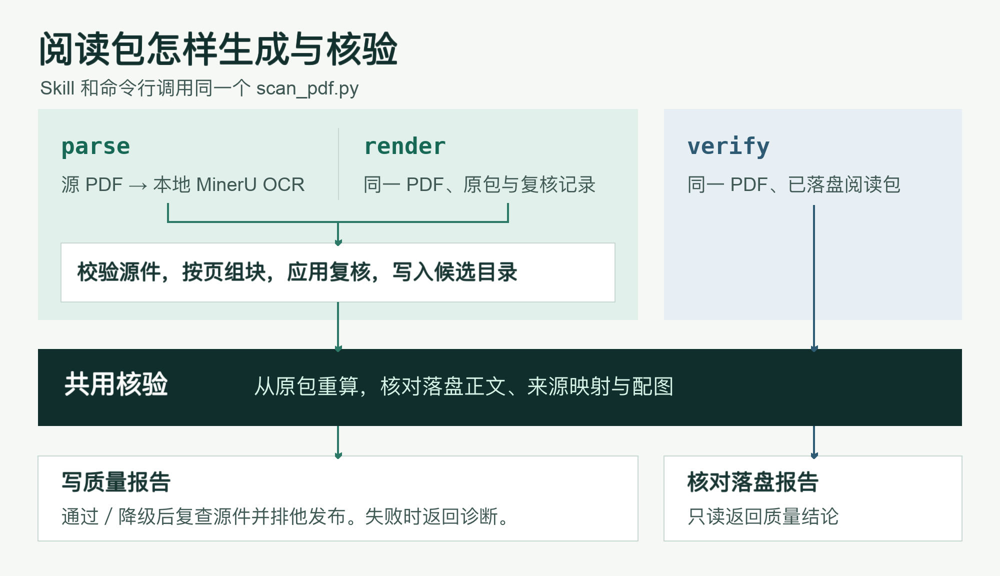
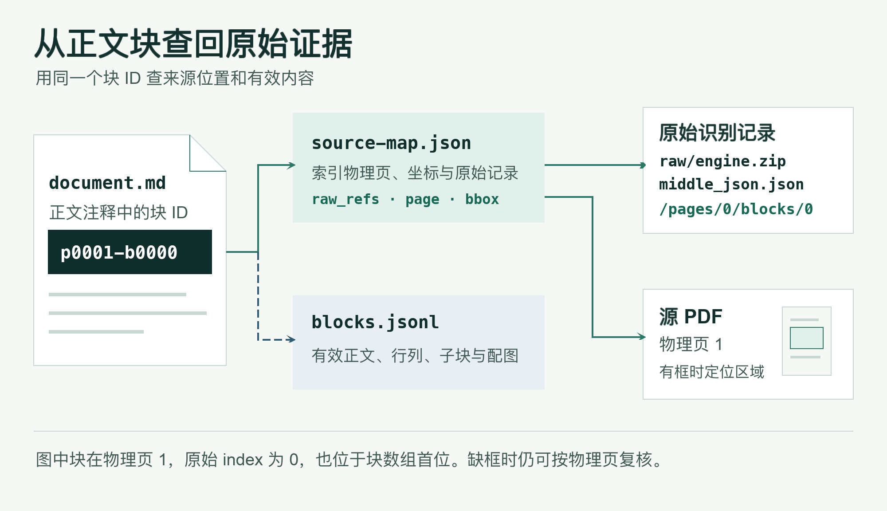

# 扫描 PDF 转可回源 Markdown 的架构与实现

本 Skill 将整份本地扫描 PDF 或混合 PDF 转成可移动的阅读包。`document.md` 和 `assets/` 同时供人阅读和下游问答、衍生创作取材。需要追溯、复核或重建时，保留完整阅读包和同一份源 PDF。本文以 `42c835e` 的实现为基线，对应 V0.2 需求中的 R1–R6。[已批准的需求](../specs/2026-11-18-scan-pdf-to-markdown-requirements.md) · [设计及后续修订](../specs/2026-11-18-scan-pdf-to-markdown-design.md)

## 1. Skill 与 CLI 共用一条转换流程

安装后的 Skill 从自己的目录调用 `scripts/scan_pdf.py`。用户省略输出目录时，Skill 选用源件旁尚未占用的 `<文件名>-markdown` 目录或其编号后缀。调用完成后，Agent 返回正文和报告的位置，说明结论和待核对的物理页或块。CLI 用户可直接使用同一脚本。[Skill 入口](../skills/scan-pdf-to-markdown/SKILL.md) · [命令实现](../skills/scan-pdf-to-markdown/scripts/scan_pdf.py)

| 命令 | 输入与行为 |
| --- | --- |
| `parse PDF --output 新目录` | 用本地 MinerU 识别整份 PDF，然后生成阅读包。 |
| `render 阅读包 --source-pdf PDF --output 新目录` | 用包内原始资料和同一份 PDF 免 OCR 重建。默认沿用包内 `review.json`，`--review 文件` 接收替换用的完整记录。 |
| `verify 阅读包 --source-pdf PDF` | 在只读模式下重算预期产物，对照磁盘上的正文、来源记录、图片和质量报告。使用被核验目录随附的复核记录。 |

本页两张图的可编辑源文件见 [PPTD 工程](./diagrams/architecture.pptd)，页文件随工程保存在 `diagrams/pages/`。

## 2. 整本 OCR 与原始资料

`capture.py` 创建源 PDF 的只读快照，调用 `mineru-kit parse`，指定所有物理页、Basic 档、`ocr` 模式和 ZIP 输出。混合页也走整页识别，正文只使用这一份有序结果。同页原生文字和扫描区域由引擎一起识别，位于不同区域的同文独立保留。采集时核对快照与源件身份，记录 PDF 的 SHA-256、字节数、物理页数、每页裁切框和旋转角，以及 ZIP 摘要和引擎实际版本、档位、识别模式。[识别与校验](../skills/scan-pdf-to-markdown/scripts/capture.py)

重放从 ZIP 读取两种视图。`middle_json.json` 的 `docvortex.middle` 2.0 记录原始页块、子块及坐标。`structured_content.json` 提供已经整理过的正文表达。读取时按源件检查两份视图的物理页覆盖，并对齐顶层块的顺序、类型、索引和框。嵌套内容和表体从原始记录定位，重复文字仍可凭块路径区分。[原始包读取](../skills/scan-pdf-to-markdown/scripts/capture.py) · [块整理](../skills/scan-pdf-to-markdown/scripts/reading.py)

首版验收环境为 macOS、Python 3.12、MinerU 4.1.7 Basic 和 ONNX CPU。`parse` 需要锁定的 OCR 依赖及本地模型，`render` 和 `verify` 在该基线只依赖 PyMuPDF。采集显式选择本地权重来源。当时复现 ONNX CPU 环境需将 `MINERU_MODEL_SMALL_BACKEND=onnx` 和 `MINERU_MODEL_ONNX_DEVICE=cpu` 传给调用进程。[当前安装说明](../README.md#安装) · [OCR 依赖与权重基线](../skills/scan-pdf-to-markdown/requirements-ocr.txt)

## 3. 从原始块生成正文与来源索引

`reading.py` 按识别顺序建立一份页、块和资产模型。物理页号从 1 起，取 `page_idx + 1`，空白或未读出正文的页也保留页标记。顶层块 ID 由物理页和原始块索引组成，例如 `p0001-b0000`，子块追加位置后缀，例如 `p0001-b0000-c0`。`raw_refs` 指向 ZIP 内 `middle_json.json` 的 JSON Pointer，指针使用从 0 起的数组下标。引擎标作页眉、页脚或页码的内容进入排除记录，附原文、位置与原因。[页块构建](../skills/scan-pdf-to-markdown/scripts/reading.py)

原始框以引擎页面的归一化比例记录。引擎页宽高与源页可见范围一致时，先将框换算为点，再消除旋转并加上裁切偏移，得到原页未旋转、左上为原点的点坐标。缺框或缺少换算依据时保留物理页、原始记录和原因。已有框数值非法、倒置或越界会导致核验失败。[坐标换算](../skills/scan-pdf-to-markdown/scripts/reading.py)

正文保留标题层级、段落顺序、列表和图题。续表只引用前一物理页最后一张表。续段按引擎标记及块类型查找前驱，普通正文可以越过夹在中间的图表。无法确定前驱时保留物理页线索并就地提示。图表题注保留各自的子块定位，图体或表体有疑点时，在对应内容旁显示原有子块 ID。[阅读顺序与正文生成](../skills/scan-pdf-to-markdown/scripts/reading.py)

简表和复杂表共用 `table_body.content` 的 HTML 行列解析器。简表写为 GitHub Flavored Markdown（GFM）表格，输出时转义字面文本，块记录仍可用原值定位和更正。跨行、跨列或带格式的表使用受控 HTML，公式沿用识别记录里的 LaTeX。疑点在相应的表格或公式附近显示。无法还原时优先展示包内区域图，能可靠定位时可从源 PDF 裁图，边界不明时保留原页线索。[表格、公式与区域图](../skills/scan-pdf-to-markdown/scripts/reading.py)

| 阅读包成员 | 职责 |
| --- | --- |
| `document.md`、`assets/` | 阅读正文和它相对引用的图片。HTML 注释中的物理页与块 ID 用于回源。 |
| `blocks.jsonl` | 每行一个顶层有效块。记录正文或行列、递归子块、原始定位、坐标、图片引用及疑点。 |
| `source-map.json` | 保存源件身份、逐页状态与排除项，以及从主块或子块 ID 到物理页和原始记录的索引。 |
| `raw/engine.zip`、`raw/source.json` | 保存引擎 ZIP 的原字节及源件、引擎与 ZIP 的身份记录。 |
| `review.json`、`qa-report.md` | 前者是随包保存的可选复核输入，后者记录本次机器检查、实际复核范围、更正和待核对项。 |

## 4. 复核和更正可随原包回放

`review.py` 先校验 `review.json` 中的 PDF 和 ZIP 摘要，再逐项检查页号或块 ID、原页依据及结论。表格更正指定从 1 起算且计入表头的行列，合并格以左上角定位。例如把 B 列首格的 `18` 更正为 `13`，引擎 ZIP 仍保存 `18`，更新后的正文和块记录使用 `13`。原值不符、目标不存在或更正相互矛盾时，命令会指出对应项并停止重建。[记录格式与更正示例](../skills/scan-pdf-to-markdown/references/review.md) · [复核实现](../skills/scan-pdf-to-markdown/scripts/review.py)

更正先作用于有效块，再计算页面或块的内容摘要。摘要绑定正文表达、呈现顺序和图片摘要。`table_body` 的行列与区域图存于父表，因此表体的摘要读取父表实际展示的行列和配图。摘要不符时，先前的结论转为待复核。若原值仍匹配，更正继续生效，正文和报告同时显示待复核提示。单格更正可以与整表疑点并存，页级确认也保留独立的块级疑点。[摘要与复核回放](../skills/scan-pdf-to-markdown/scripts/review.py)

## 5. 质量结论与发布

`verify.py` 从源件、原 ZIP 和复核记录重新生成预期的正文、块及来源映射，与实际文件逐一比对，并检查登记配图可解码、摘要一致。核验已落盘目录时，缺失或过期的 `qa-report.md` 也会导致失败。机器核验负责完整性和重放一致性。原页复核负责判断内容是否可信，包括首、中、末页、难辨版面和已标记的异常。[核验实现](../skills/scan-pdf-to-markdown/scripts/verify.py) · [质量判定](../skills/scan-pdf-to-markdown/scripts/review.py)

未读出正文的页面按原页证据区分。渲染像素全白时记为空白。有 PDF 文本层证据时记为识别失败。其余页面待核对，可用原页复核确认空白或有内容。[页状态](../skills/scan-pdf-to-markdown/scripts/reading.py) · [页级复核](../skills/scan-pdf-to-markdown/scripts/review.py)

| 结论 | 退出码 | 判定 |
| --- | --- | --- |
| 失败 | `1` | 源件、页块、坐标、产物完整性有问题，或整本没有可读正文且仍有非空白页或待确认页。 |
| 降级 | `0` | 完整性通过，存在未完成的原页复核、局部识别失败或待核对内容。 |
| 通过 | `0` | 完整性通过，规定的原页复核及问题处理已完成。 |

`parse` 和 `render` 在目标父目录写独立的候选目录，先重算核验候选文件，再写报告和重查源件身份。通过或降级时用 macOS 排他目录重命名一次发布。目标已存在或并发争用时，命令返回失败并保护已有结果。整本无可读正文但候选文件完整时，失败诊断会保留候选目录供后续 `render`。全空白得到确认后，仍按页输出标记，并依据复核覆盖范围给出质量结论。[生成与发布](../skills/scan-pdf-to-markdown/scripts/scan_pdf.py)

## 6. 如何对照规格验证实现

| 原规格场景 | 可观察的结果 |
| --- | --- |
| A1 阅读与取材（R1、R2） | 移动阅读包后，在阅读器打开正文与配图，对照原件检查混合页顺序与图题。只给模型正文与配图，核对模型引用的原句、指定行列的读数和指出的疑点。 |
| A2 逐块查证（R3） | 从段落、图片、表格的 ID 查到物理页和 ZIP 内原记录。将已换算的框叠回原页，核对旋转页与缺框记录。 |
| A3 质量结论（R2、R4） | 对照空白、失败和待核对内容，检查空白待确认的候选目录能否在复核后重建。移走副本中的配图或报告，核验应失败并定位文件。检查失败后仍能访问先前结果。 |
| A4 免 OCR 重建（R5） | 在读取环境重建并比对正文、来源和图片摘要。更正一格后重放，再把源件换成同名异内容的 PDF，核对身份拦截。 |
| A5 双入口（R6） | 在仓库外分别运行 CLI 和已安装的 Skill，比对正文、配图、定位和质量结论。 |

在这一实现基线中，列表里的 `` 和 `__init__` 可能被当成图片或加粗语法，`verify` 检查的是登记配图。复杂表单格更正会用替换值重写整格的行内标记，可能丢失同格上下标。页状态以可读正文为先，纯插图页即使配图可用，仍可能因缺少可读正文被判为待核对或识别失败。[正文生成](../skills/scan-pdf-to-markdown/scripts/reading.py) · [更正实现](../skills/scan-pdf-to-markdown/scripts/review.py) · [核验实现](../skills/scan-pdf-to-markdown/scripts/verify.py)
