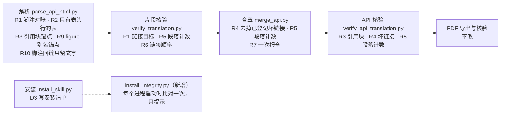

# CUDA 13.5 升级重译问题修复设计

| 元数据 | 内容 |
| --- | --- |
| 文档版本 | V0.6 |
| 文档状态 | V0.6 于 2026-11-16 批准 |
| 创建 / 修订日期 | 2026-11-14 / 2026-11-16 |
| 适用范围 | `tech-doc-translator` 的多页面 API 解析、合章导航与核验，翻译约定，`SKILL.md`，安装脚本；另改仓库级安装测试合同 `tests/installer_contract.py`（§5.6） |
| 权威需求 | [CUDA 13.5 升级重译问题修复需求](./2026-11-14-cuda-upgrade-retranslation-fixes-requirements.md) V0.4，2026-11-16 批准；R1–R10、V1–V15，D1–D3 均选 A |
| 基线 | `zn_dev`，从 `main` @ `af470db` 切出，组件目录与 `6748024` 相同；共享安装于 2026-11-14 19:59 比对 |
| 既有设计 | [CUDA 翻译实践优化设计](./2026-10-23-cuda-practice-optimization-design.md) §6 表格链路、§14 导航 |

## 1. 目标与边界

按需求修 R1–R10；D1–D3 都按方案 A 做。用户能看到的结果见需求 §1：共享安装与仓库一致，不写项目补丁就能完成解析、合章和核验；按翻译约定写出的译文能通过核验；一次合章报出全部问题；`SKILL.md` 里能找到升级重译可用的导航恢复。

改动只落在仓库 `tech-doc-translator/` 的脚本、`SKILL.md`、`references/` 和测试，外加仓库级安装测试合同（§5.6）。不新增命令行工具，不发版。CUDA 各项目原件只读，设计期验证和实施验收都用工作区外副本。共享安装在合并主分支后由用户按 §5.5 重装，不在本次开发内。

每个问题都在现有机制上改，不另建平行机制：锚点绑定只改段落枚举和对象种类（含 figure 别名）；坏链接处置走现有的 `target_for`、`replace_links`，登记放进现有来源记录；脚注回链在现有的行内渲染里只留文字；安装清单由现有安装脚本写出。

## 2. 总览



图中每步标的是用户在这一步最先看到的变化。表格事实、段落枚举这类共享函数改一处，后面各步同时生效。

| 需求 | 改什么 | 文件 | 落点 | 现有 / 新增 |
| --- | --- | --- | --- | --- |
| R1 | 写权限一节加“不改已安装的 Skill 目录” | `SKILL.md` | 改 SKILL.md | 现有章节加一条 |
| R1 | 收回 BPG 的对账修复，脚注引用只取编号 | `_source_reconcile.py`、`_html_fidelity.py` | 改组件脚本 | 现有函数修改，抽出一个取号函数 |
| R1 | 链接正则认出包裹图片的外层链接，链接文字不跨空行 | `_verification.py` | 改组件脚本 | 只改一个正则 |
| R1 | 合并主分支后备份并按仓库重装共享安装 | 共享安装 | 用户操作，不在本次开发内 | 用现有安装脚本 |
| R1 · D3 | 安装时写清单；入口运行时比对，有改动就提示 | `install_skill.py`、`_install_integrity.py`、`_verification.py`、`merge_sections.py`、`prepare_pdf_source.py`、`tests/installer_contract.py` | 改安装脚本、组件脚本、仓库测试合同 | 新增一个模块和一个安装产物 |
| R2 | 表头分隔行计入表格行 | `_source_reconcile.py` | 改组件脚本 | 现有函数加一行 |
| R3 | 引用块成为来源对象；存量恢复按位置对应同一节的引用块 | `_api_navigation.py` | 改组件脚本 | 现有对象表加一类；恢复筛选沿用段落规则 |
| R4 | 来源记录登记源文坏链接，合章去掉已登记的链接；存量恢复遇到已登记的跨页坏链接仍报原错 | `verify_delivery.py`、`_api_navigation.py` | 改组件脚本；来源记录加可选字段 | 现有转换入口扩展 |
| R5 | 约定每种结构提示的写法；段落按规范枚举；提示框标签放宽 | `translation_conventions.md`、`_api_navigation.py` | 改参考文档、组件脚本 | 现有函数修改 |
| R6 | 约定写明链接顺序；API 片段核验查顺序 | `translation_conventions.md`、`build_work_package_tasks.py`、`verify_translation.py`、`_api_navigation.py` | 改参考文档、组件脚本 | 现有检查加一项 |
| R7 | 合章汇总所有页、所有类别的问题，报错带位置 | `merge_api.py`、`_api_navigation.py` | 改组件脚本 | 现有流程改为收集后报告 |
| R8 | 说明升级重译可用的导航恢复及限制 | `SKILL.md` | 改 SKILL.md | 现有章节加一条 |
| R9 | figure 开头的别名 id 登记为其中的图片，解析端写出别名锚点 | `_api_navigation.py` | 改组件脚本 | section 别名的识别抽成一个函数，figure 共用 |
| R10 | 脚注、引文的回链在行内渲染里只留文字 | `_html_fidelity.py` | 改组件脚本 | 现有函数加一条规则 |

文中脚本路径均在 `skills/tech-doc-translator/scripts/` 下，行号是仓库 `zn_dev` 当前内容；标“共享安装”的行号是共享安装里的文件。

## 3. 基线与机制重审

### 3.1 改动依赖的现有接口

| 接口 | 现在的行为 | 对设计的约束 |
| --- | --- | --- |
| `anchor_diffs`、`compare_anchors`（`_api_navigation.py` 第 198、314 行） | 锚点后紧跟的对象按“种类 + 序号”比对。段落序号来自 `_markdown_paragraphs`；源侧由 `api_paragraph_positions`（`_source_reconcile.py` 第 1979 行）把 DOM 段落对到解析稿段落序号 | 两侧共用同一个段落枚举函数，改它一处，源侧与译文侧同时生效 |
| 残留标记检查（`verify_translation.py` 第 141–149 行，调 `_verification.py` 第 1894 行的 `residual_markers`） | 片段模式照样检查；`[DEF-LIST]`、`[FOOTNOTE-LIST]` 在标记清单里，行首的 `[BLOCKQUOTE]`、`[DETAILS]` 由块级占位符正则（第 16 行）认出，都报 FAIL | 约定写法不能在译文里留下任何结构提示行（§9.1） |
| `_source_anchors`（`_api_navigation.py` 第 77 行） | 只登记标题、表格、图片、段落、代码、提示框六类对象 | 新对象种类要在 DOM 侧、解析端锚点输出、Markdown 侧三处同时加 |
| `_section_head`、`source_anchor_ids`（第 59、116 行） | section 开头的空 `<span id>` 当作标题的别名，登记并写出锚点；figure 只登记、写出自身 id | figure 别名沿用同一条识别规则，DOM 侧和解析端锚点输出两处一起改 |
| `render_inline` 的链接转换（`_html_fidelity.py` 第 885–890 行） | 所有带 `href` 的 `<a>` 都写成 Markdown 链接；四类 HTML 解析入口共用 | 回链只留文字的规则放在这里，脚注的简单和富内容两条渲染路径一起生效 |
| `target_for`、`replace_links`、`_link_edits`（第 424、374、337 行） | 合章转换、核验预期、表格还原都调这一组函数 | 坏链接处置放在这里，三处自动一致 |
| `load_navigation`（第 378 行）调 `verify_delivery.check_source_chains(source_only=True)` | 快照条目只保留已知字段（`verify_delivery.py` 第 1369–1374 行），其他字段被丢掉 | 来源记录加字段，要在这里放行并校验类型 |
| `install_skill.py`、`tests/installer_contract.py` | 预检不过不写文件；合同要求安装后的文件集合等于受管文件集合（合同第 186 行） | 安装清单是安装脚本生成的文件，合同要能声明它 |
| 入口的导入关系 | 四类 HTML 解析入口、各 `verify_*` 入口、`merge_api`、`merge_work_packages` 都会导入 `_verification`（直接或经 `_html_fidelity`、`_source_reconcile`）；`merge_sections.py`、`prepare_pdf_source.py` 顶层不导入 | 运行时比对挂在 `_verification` 导入时，另两个入口单独调用 |

### 3.2 机制重审

来源锚点绑定和格内代码归属都是第二轮修；来源记录加字段、安装加清单改了持久合同或新增机制。按仓库规则先重审，再定方案。

| 机制 | 正常路径 | 本次失败 | 根因 | 选择 | 不选的方案 |
| --- | --- | --- | --- | --- | --- |
| 来源锚点绑定：V1.4 引入，V1.6 扩到存量恢复与 PDF，本轮 R3、R5、R7、R9 再改 | 译文保留解析稿的块结构，两侧段落序号一致 | 按约定改写结构提示后段落数变了（R5）；带 id 的引用块不是对象（R3）；figure 开头的别名不是对象（R9）；只报第一处错（R7）；存量恢复的逐种类筛选里没有引用块的规则，同节两个带 id 引用块整章恢复失败 | 段落序号直接取 markdown-it 的顶层段落，不随已批准的改写保持不变；对象种类缺引用块，恢复筛选也没有它的规则；docutils 的多 id 写法（元素开头的空 span）只在 section 识别 | 收敛：一个规范段落枚举，两侧共用；加引用块对象；别名识别抽成一个函数，section 与 figure 共用；存量恢复的逐种类筛选补上引用块（沿用段落规则） | 存量恢复跳过引用块：恢复出的合章里，指向引文的链接没有目标；只写使用限制：含这种页的章恢复不了；按症状继续放宽（cuBLAS 改成“段落只比种类”）：锚点挪到别的段落前不再被发现；改用内容指纹绑定：要新增持久事实并改全部消费者，超出需要；按页豁免链接（PG 项目补丁的做法）：豁免的链接不再被核对 |
| 格内代码归属：V1.4 建立（CUDA 优化需求 R3），本轮 R2 | 表格有数据行，从最后一行数据后开始认领 | 只有表头行的表，认领停在分隔行 | `[TABLE]` 记录的表格行集合不含分隔行；GFM 记录含（`_source_reconcile.py` 第 1730–1734 行） | 收敛：`[TABLE]` 记录也把分隔行算进去 | PG 项目补丁“孤儿标记挂到最近的前一张表”：真正的孤儿标记也会被挂上，该报的错被掩盖 |
| 来源记录：R4 加可选字段 | — | — | — | 每个快照可选 `source_broken_links`；读取时回原快照校验。记录摘要已进核验依赖，改登记即旧证据失效 | 命令行参数：合章、核验、导出要传同一组值，容易不一致；单独登记文件：多一个要绑定的产物 |
| 安装：D3 新增 | — | — | — | 安装时写清单，运行时只读比对 | 把清单作为受管文件提交到仓库：每次改动都要重新生成，开发时清单一过期就误报 |

## 4. 设计期验证

在工作区外复制仓库 HEAD 的脚本，按本设计 §5.3、§5.4、§6、§7、§9 改出第一份临时原型，用真实样本跑。原型只证明方案可行，不是实现；实施时按本设计重写并配测试。R4、R6、R7 和 D3 不在这份原型里，随执行计划 01–09 进入下文的第二份原型。表中“HEAD”是仓库现状，两边都不加项目补丁。

| 验证项 | HEAD | 原型 | 对应 |
| --- | --- | --- | --- |
| PG 13.5 全部 54 页解析对账 | 52 页通过；async-barriers、pipelines 失败 | 54 页通过 | R1、R2、R3、R5 |
| BPG 13.5 单页 21 节逐节对账 | 4 节失败 | 全部通过 | R1 |
| async-barriers：交换两张表的格代码；删掉一个围栏 | — | 分别报 3 处、4 处差异 | R2 |
| 引用块：DOM 与解析稿逐页计数 | — | 54 页一致 | R3 |
| unified-memory：引用块改为 `>` 写法；互换 cit1、cit2 两个锚点 | 引用块不是对象 | 绑定通过；互换后两处都报错绑 | R3 |
| mathematical-functions：11 处 `[BLOCKQUOTE]` 全改为 `>` | 报错绑 1 处 | 通过；段落锚点挪到下一段前，报错绑 | R5 |
| cpp-language-extensions：`[DEF-LIST]` 去掉标记、排版不变；或术语行末加 `\` | 通过 | 通过 | R5 |
| cpp-language-extensions：`[DEF-LIST]` 术语行之间插空行 | 报错绑 3 处 | 报错绑 3 处（违反约定，应当报） | R5 |
| `compare_anchors`：PG 现有 53 页译文、cuBLAS 33 个译文包 | 全部通过 | 全部通过 | R5 |
| `link_targets`：链接包裹图片 | 返回图片地址 | 返回外层链接目标 | R1 |
| `link_targets`：`区间 [a, b) 的说明。` 空一行后接图片，再接 `[c](#c)` | `['images/b.png', '#c']` | `['#c']` | R1 |
| `link_targets`：`区间 [a, b) 的说明。` 空一行后直接接 `[c](#c)` | `['#c']` | `['#c']`；共享安装版返回 `[]` | R1 |
| cuBLAS `wp_021` 片段的链接目标 | 缺 3 个（图片地址被当成链接） | 51 对 51，无缺失 | R1 |

提示框标签放宽（§9.3）是 PG 现有译文继续通过的必要条件：不放宽时，cpp-language-extensions 的译文多算 6 个段落，`compare_anchors` 失败。

第二份原型（2026-11-15）用于 R9、R10：工作区外副本先套用执行计划 01–09 的改动，代码直接取自计划文档；再加 §13、§14 的改动，用真实样本跑。PG 副本里 unified-memory、extended-gpu-memory、async-copies 三页的译文按约定准备，extended-gpu-memory 的坏链接按 D2 登记。

| 验证项 | 只有 R1–R8 | 加 R9、R10 | 对应 |
| --- | --- | --- | --- |
| PG 13.5 全部 54 页解析对账 | 54 页通过 | 54 页通过。与 PG 现有解析稿相比只有 4 页变化：unified-memory（R3）；async-copies 多 3 行别名锚点（R9）；compute-fabric-transport、compute-capabilities 的回链变成纯文字（R10） | R9、R10 |
| PG 现有的旧解析稿，用新代码检查 | — | 源侧对账：async-copies、compute-fabric-transport、compute-capabilities 都无差异。导航准入：async-copies、unified-memory 报“缺来源对象锚点” | §15 |
| PG 副本逐章合章与 API 核验 | 第 1、2、3、6 章通过；第 4、5 章失败 | 第 1–6 章全部通过。第 4 章里 3 处图链接、5 处引文链接都指向对应的命名空间锚点，坏链接成了纯文字，脚注回链为 `(1, 2, 3)` | V13–V15 |
| BPG 13.5 单页 21 节逐节对账；cuBLAS `wp_021` 链接目标 | 通过 | 通过 | R10 不碰 dl 写法 |
| 新增用例 | — | figure 别名 2 个、多回链 2 个，都是先失败后通过 | V13、V14 |
| 受影响的 18 个单测文件与 6 个 shell 套件 | 通过 | 通过 | V12 |
| 全量 pytest | 1372 个通过 | 1376 个通过（多出的 4 个是新增用例）；失败集合与改动前相同 | V12 |

两份原型之后定下的两处没有原型：§9.1 里含代码或表格的引用块的写法，由 V7 实跑；§11 里链接转换失败时照常检查表格，由 V9 的回归测试覆盖。

## 5. R1 共享安装只读与就地修改收回

### 5.1 写权限规则

`SKILL.md` 第 126–130 行（现有）：

```markdown
## 每类参与者写权限

- 主 Agent：可写术语表、最终译文、全局映射、交付说明。
- 翻译 Agent：只写分配给自己的译文目标；不得改源、术语表、他人产物。
- 脚本：只读输入、写指定输出；不翻译、不裁决术语、不静默修复原文。
```

末尾加一条（拟议）：

```markdown
- 所有参与者：不改已安装的 Skill 目录（`<SKILL目录>` 下的脚本、参考文件和资源）。发现组件缺陷时，在项目 `scripts/` 用运行时包装处理，并在交付说明里记下缺陷、包装位置和复现样本，供回流组件。
```

### 5.2 就地修改的处置

19:59 比对时共享安装有 7 个文件与仓库不同：需求附录 A.1 列出的 6 个，加上 15:07 改的 `assets/pdf/style.css`（给表格加 `table-layout: fixed`，注释写的是“13.4 交付验证”）；`verify_pdf.py` 15:59 又改了一次。实施时再比对一次，按下表处置。

| 文件 | 来源 | 处置 |
| --- | --- | --- |
| `scripts/_source_reconcile.py` | BPG | 合入，脚注引用改为只取编号（§5.3） |
| `scripts/_verification.py` | cuBLAS | 不照搬，按 §5.4 改写后合入 |
| `scripts/_api_navigation.py` 的 `compare_anchors` | cuBLAS | 不合入。其中“段落只比种类”由 R5 取代；“容忍译文多出的锚点”（为 PDF 补设的脚注引用锚点）不是同一问题，不在本文范围 |
| `scripts/verify_translation.py`、`scripts/verify_pdf.py`、`scripts/export_pdf.py`、`assets/pdf/style.css` | cuBLAS、cuSPARSE、13.4 交付验证 | 不评估，不合入 |

### 5.3 脚注引用只取编号

渲染端只取数字，`_html_fidelity.py` 第 862–865 行（现有）：

```python
        for ref in copied.find_all(class_='footnote-reference'):
            number = re.sub(r'\D', '', ref.get_text(strip=True))
            ref.replace_with(
                '[^%s]' % number if number else self._unknown_footnote)
```

BPG 加的源侧处理取整段文字，共享安装 `scripts/_source_reconcile.py` 第 939–941 行（就地修改，仓库里没有）：

```python
        for anchor in list(el.find_all(class_='footnote-reference')):
            anchor.replace_with(NavigableString(
                '[%s]' % anchor.get_text(strip=True)))
```

PG 的脚注引用带方括号，`get_text` 取到 `[1]`，再套一层成 `[[1]]`；BPG 的不带方括号，取到 `1`，结果正确。改法是让两边用同一个取号函数。

`_html_fidelity.py`，新增模块级函数（拟议）：

```python
def footnote_ref_number(ref):
    """脚注引用的编号；渲染端与源侧对账共用同一取法。"""
    return re.sub(r'\D', '', ref.get_text(strip=True))
```

`_html_fidelity.py` 第 863 行改为 `number = footnote_ref_number(ref)`。`_source_reconcile.py` 合入的 `_SourceFacts._bracket_footnote_refs`（拟议）：

```python
    @staticmethod
    def _bracket_footnote_refs(el):
        from bs4 import NavigableString
        for anchor in list(el.find_all(class_='footnote-reference')):
            anchor.replace_with(NavigableString(
                '[%s]' % (footnote_ref_number(anchor) or '?')))
        return el
```

没有数字时写 `[?]`：渲染端这时写未知脚注（API 家族 `[^?]`，其他家族 `[?]`），输出侧归一后都是 `[?]`。`_source_reconcile.py` 第 19 行已从 `_html_fidelity` 导入，加上这个名字即可。

BPG 的其余改动按共享安装原样合入：

| 共享安装中的位置 | 改动 |
| --- | --- |
| `_admonition_texts`（第 898–900 行） | 在副本上把脚注引用换成 `[N]` 再取提示框文字 |
| `_primary_text`（第 952–957 行） | 同上；跳过只有空白的文本子节点，定义首行不再读成空 |
| `_content_seq`（第 1073 行）、`_cell_text`（第 1164 行） | 同上，覆盖列表项和表格格位 |
| Markdown 侧脚注引用计数（第 1385–1391 行） | 只有行首的 `[^N]:` 算定义；正文里跟冒号的 `[^N]` 仍算引用 |

生效位置：`_SourceFacts` 是四类 HTML 解析入口的源对账（`reconcile_html_to_markdown`）和交付核验源对账共用的源侧事实，BPG（单页家族）和 PG（API 家族）都经过这里。

### 5.4 链接目标的正则

`_verification.py` 第 18 行、第 285–287 行（现有）：

```python
_LINK = re.compile(r'(?<!!)\[(?:\\.|[^\\\]])+\]\(([^)]+)\)')
```

```python
def link_targets(text):
    """按文档顺序返回 Markdown 非图片链接目标。"""
    return _LINK.findall(text)
```

有两种误配。链接文字不能含 `]`，所以 `[](big.png)` 只配到里面的图片地址。链接文字能跨空行，所以 `[a, b)` 会和下一段的 `](…)` 连成假链接。cuBLAS 的就地修改把含空行的匹配、与图片重叠的匹配都丢掉：外层链接目标随之丢失；被丢掉的假匹配里如果包着一个真链接，真链接也丢了（§4）。

只改正则，`link_targets` 的函数体不变。`_verification.py` 第 18 行（拟议）：

```python
# 链接文字里可以有一整个图片；链接文字不跨空行（行内链接不跨段落）
_LINK = re.compile(r'(?<!!)\[(?:\\.|!\[[^\]\n]*\]\([^)\n]*\)|\n(?![ \t]*\n)|[^\\\]\n])+\]\(([^)]+)\)')
```

生效位置：`verify_translation.py` 第 313、319 行（单页和片段核验的链接目标）；`verify_reference_translation.py` 第 289 行；`compare_translation_tables` 逐格比较链接（`_source_reconcile.py` 第 1904 行）。

不换成 markdown-it 的 `links()`：`links()` 返回规范化后的地址（百分号编码等），`link_targets` 返回原文写法，换掉会改变各家族核验的输出口径。这里只修两种已知误配。

### 5.5 重装

合并主分支后由用户按以下步骤重装，不在本次开发内。

1. 拿共享安装与改动前的组件（`6748024`）再比对一次，确认就地修改仍只有 §5.2 所列；有新的，按 §5.2 的原则补充处置。
2. 把共享安装里与仓库不同的文件原样备份到工作区外、且不在 `~/.agents/skills/` 下的位置（放在那里会被当成另一个 Skill 加载）。位置由用户定。
3. 通知用这些就地修改的会话：BPG、cuBLAS、cuSPARSE 和做 13.4 交付验证的会话。
4. 运行 `CODEX_HOME=/Users/nanzhang/.agents ~/.venvs/tech-doc-translator/bin/python tech-doc-translator/install_skill.py --force`。本机 PATH 上的 `python3` 是 3.9.6，组件脚本在 3.9 下导入会失败（如 `_api_navigation.py` 的 `str | None` 注解），统一用这个 venv。
5. 不带 `--force` 再跑一次，正常结束；安装目录里有 `.install-manifest.json`；运行任一核验入口，没有提示。

重装后各项目的检查器摘要会变。交付核验把核验脚本及其共享依赖的摘要绑进证据（`verify_delivery.py` 第 457–490、2267–2272 行），各项目按现有规则重新登记。

### 5.6 D3：安装清单与运行时提示

安装时把受管文件的摘要写进安装目录；解析、合章和核验运行时比对一次，不一致就在输出开头列出被改的文件，结果照常产出。

| 挂接方式 | 改动 | 取舍 |
| --- | --- | --- |
| 在 `_verification` 导入时比对（采用） | 新增一个模块；`_verification.py` 加一行；`merge_sections.py`、`prepare_pdf_source.py` 各加一行 | §3.1 所列入口都已导入 `_verification`，以后加的入口多半也会导入 |
| 每个入口的 `main()` 里显式调用 | 约 15 个入口各加两行 | 写法显式，但新入口容易漏 |

**安装脚本写清单。** `install_skill.py` 第 163–178 行的 `install()`（现有）先预检、再写受管文件、再 `verify(target, sources)`，最后返回文件数。在 `verify` 之后、`return` 之前加一行 `write_manifest(target, sources)`；同文件顶部加 `import hashlib`、`import json`，并新增（拟议）：

```python
MANIFEST_NAME = ".install-manifest.json"


def write_manifest(target_root, sources):
    """安装清单：受管文件的 sha256。内容不变时不重写，重复安装保持幂等。"""
    files = {rel: hashlib.sha256(data).hexdigest() for rel, (data, _mode) in sources.items()}
    content = (json.dumps({"files": files}, indent=1, sort_keys=True) + "\n").encode("utf-8")
    path = target_root / MANIFEST_NAME
    if not path.is_file() or path.read_bytes() != content:
        atomic_write(path, content, 0o644)
```

文件头说明里“--force 只替换受管文件，清单外目标文件保持不变”一句，补上“安装清单由安装脚本维护”。

**运行时比对。** 新文件 `scripts/_install_integrity.py`（拟议）：

```python
"""已安装副本与安装清单的比对：只提示，不阻断。"""
import hashlib
import json
import os
import sys

_ROOT = os.path.dirname(os.path.dirname(os.path.abspath(__file__)))
_checked = False


def warn_if_modified():
    global _checked
    if _checked:
        return
    _checked = True
    path = os.path.join(_ROOT, '.install-manifest.json')
    if not os.path.isfile(path):
        return  # 仓库检出，或不是用安装脚本装的：不比对
    try:
        with open(path, encoding='utf-8') as handle:
            entries = sorted(json.load(handle)['files'].items())
    except (OSError, ValueError, KeyError, TypeError, AttributeError):
        print('警告: 安装清单读不出: %s' % path, file=sys.stderr)
        return
    changed = []
    for rel, digest in entries:
        try:
            with open(os.path.join(_ROOT, rel), 'rb') as handle:
                actual = hashlib.sha256(handle.read()).hexdigest()
        except OSError:
            changed.append(rel + '（缺失）')
            continue
        if actual != digest:
            changed.append(rel)
    if changed:
        print('警告: 已安装的 tech-doc-translator 与安装清单不符（可能被就地修改），结果照常产出: %s。从仓库重装可恢复。'
              % '、'.join(changed), file=sys.stderr)
```

调用位置：`_verification.py` 顶部导入之后（第 13 行后）加 `from _install_integrity import warn_if_modified` 与 `warn_if_modified()`；`merge_sections.py` 的 `main()`（第 36 行）和 `prepare_pdf_source.py` 的入口开头各调用一次。只写 stderr，不改退出码和 stdout；每个进程最多一次。83 个受管文件约 2.9 MB，实测全部算一遍摘要约 3 毫秒。

清单内容不是预期结构（JSON 顶层不是对象、没有 `files`、`files` 不是对象）时，读取会抛 `TypeError`、`KeyError` 或 `AttributeError`，都按“读不出”提示后返回，不让入口崩溃。清单只列受管文件，安装目录里多出的文件（运行时生成的 `scripts/__pycache__/`、项目放进去的文件）不比对，也不提示。覆盖边界：`consolidate_glossaries.py`、`discover_pages.py`、`merge_glossary.py`、`select_glossary.py` 不导入 `_verification`，运行它们不比对；它们只处理术语表和页面发现，不产出解析、合章或核验结论。

**安装测试合同。** `tests/installer_contract.py` 第 38–44 行的 `InstallerContract`（现有）加一个字段 `generated_files: tuple = ()`；第 186 行 `assert installed_files == set(managed)` 改为 `assert installed_files == set(managed) | set(contract.generated_files)`。tech-doc-translator 的合同声明 `(".install-manifest.json",)`；online-media-reader 不声明，行为不变。其余合同检查不受影响：清单内容不变时不重写，预检失败时什么都不写。tech-doc-translator 自己的安装测试另加 V11 的用例。

## 6. R2 只有表头行的表

`_source_reconcile.py` 第 1705–1708 行（现有），表格行扫描遇到分隔行直接跳过：

```python
            cells = line.split(' | ')
            if all(cell.strip() and _MD_TABLE_SEP_CELL_RE.match(cell.strip())
                   for cell in cells):
                continue  # 表头分隔行（单列 --- 同样适用）
```

同文件第 1751–1753 行（现有），格内代码从最后一个表格行之后开始认领：

```python
            record['group_end_line'] = max((line + merged_lines.get(line, '').count('\n')
                for line in record['row_lines']), default=record['start_line'])
            cursor = record['group_end_line'] + 1
```

只有表头行的表，表格行只有表头这一行，认领从分隔行开始，第一行就不是标记，于是停下。GFM 表格记录的表格行取自 markdown-it 的整块范围，本来就含分隔行（第 1730–1734 行）。

第 1708 行前加一行（拟议）：

```python
            if all(cell.strip() and _MD_TABLE_SEP_CELL_RE.match(cell.strip())
                   for cell in cells):
                current['row_lines'].add(line_no)  # 分隔行属于表格，与 GFM 记录一致
                continue  # 表头分隔行（单列 --- 同样适用）
```

有数据行的表，最后一行数据仍在分隔行之后，认领起点不变；只有表头行的表从分隔行之后开始认领。`row_lines` 另有两个消费者：第 1362 行扫描脚注定义时跳过表格行；第 2593–2633 行表格行里的代码、公式、图片不进通用内容流。分隔行里没有这些内容，不受影响。

生效位置：`table_records` 是 `markdown_table_facts` 的来源，解析对账、`compare_translation_tables`、`table_code_problems` 和合章时的表格检查都经过这里。

## 7. R3 引用块作为来源对象

`_api_navigation.py` 第 84–88 行（现有），DOM 侧对象表只有六类：

```python
    codes = [node for node in root.find_all('pre') if visible(node)]
    objects = {id(node): (kind, index) for kind, nodes in [
        ('heading', headings), ('table', tables), ('image', images),
        ('paragraph', paragraphs), ('code', codes), ('admonition', admonitions),
    ] for index, node in enumerate(nodes, 1)}
```

第 116–120 行（现有，节选），解析端只给这几类对象写锚点。调用者是 `parse_api_html.py` 第 148–149 行，在每个子节点渲染前写 `<a id>` 行；引用块随后在第 188–191 行写成 `[BLOCKQUOTE]`。

```python
def source_anchor_ids(node):
    """渲染端只在确定对象的块入口发出其自身原 ID。"""
    if (node.name in ('table','figure','img') or _paragraph(node) or _admonition(node)
            or re.fullmatch(r'h[1-6]',node.name or '')):
        return [node['id']] if node.get('id') else []
```

第 192–195 行（现有），Markdown 侧对象：

```python
    objects.extend((line, 'admonition', index) for index, line in
                   enumerate(_markdown_admonitions(text), 1))
    order = ('heading', 'table', 'image', 'code', 'paragraph', 'admonition')
    return sorted(objects, key=lambda item: (item[0], order.index(item[1])))
```

`_api_navigation.py` 新增两个函数（拟议）：

```python
def _blockquote(node):
    """解析端在列 0 写出 [BLOCKQUOTE] 的引用块：不在 pre/code/table/li/dt/dd 里。"""
    return (node.name == 'blockquote'
            and not node.find_parent(['pre', 'code', 'table', 'li', 'dt', 'dd']))


def _markdown_blockquotes(text):
    """Markdown 侧引用块对象：顶层 [BLOCKQUOTE] 行，或不是提示框的顶层 > 引用块。"""
    lines = text.splitlines()
    prose = '\n'.join('' if ANCHOR.fullmatch(line) else line for line in lines)
    admonitions = _markdown_admonitions(text)
    found = []
    for token in _INLINE.parse(prose):
        if token.level or not token.map:
            continue
        start = token.map[0] + 1
        if token.type == 'blockquote_open' and start not in admonitions:
            found.append(start)
        elif token.type == 'paragraph_open' and re.match(r'\[BLOCKQUOTE\](\s|$)', lines[start-1]):
            found.append(start)
    return found
```

另外三处各加一项：

- `_source_anchors` 第 84 行后加 `blockquotes = [node for node in root.find_all(_blockquote) if visible(node)]`，对象表加 `('blockquote', blockquotes)`；
- `source_anchor_ids` 第 118 行的条件加 `or _blockquote(node)`；
- `markdown_objects` 加 `objects.extend((line, 'blockquote', index) for index, line in enumerate(_markdown_blockquotes(text), 1))`，`order` 里 `'blockquote'` 放在 `'paragraph'` 前面：译文的 `>` 引用块和它的第一段从同一行开始，紧随锚点的对象要先认引用块。

`_blockquote` 与解析端的输出位置一致：提示框里的引用块，解析端在提示框之后按列 0 写出，算对象；列表项、定义项里的被缩进，不算。§4 验证了 54 页 DOM 与解析稿的引用块数都相等。

生效：unified-memory 的解析稿在两个引文引用块前多出两行锚点（`um-legacy-memcpy-cit1`、`um-legacy-memcpy-cit2`）；其余 53 页没有带 id 的引用块，解析稿不变。`anchor_diffs`、`compare_anchors`、`transform_page` 的锚点改名和 `target_for` 都按对象表工作，不用另改；合章后正文 5 处 `(1)`、`(2)` 转成指向这两个锚点的命名空间链接。

译文里引用块的写法见 §9.1。PDF 侧沿用现有处理（CUDA 优化设计 §14：引用块前的锚点放进首个实际段落）。这两处在 PDF 里能否跳到位，需在 PG 导出 PDF 时实测，不在 V5 里。

**存量恢复。** R3 生效后，存量恢复（`--recover-navigation-from`）要在旧合章的同一节里给带 id 的引用块找对象。`_recovery_object_lines` 第 798 行（现有）给标题、代码、图片、表格、段落、提示框都写了筛选规则，唯独引用块没有：

```python
        elif kind == 'paragraph':
            src_group = [line for (role, _), line in source_objects.items()
                         if role == kind and bisect_left(source_heads, line) == section]
```

拟议：引用块沿用段落规则（同处改一行）：

```python
        # 引用块沿用段落规则：同一节数量相等就按位置对应，不相等就报错
        elif kind in ('paragraph', 'blockquote'):
```

生效位置：`recover_navigation` 和 `verify_recovery` 都经过 `_recovery_object_lines`。同一节内当前合章的 `>` 引用块数与解析稿的引用块数相等就按位置对应；不相等（先经 `_following_list_code` 签名兜底，仍不唯一）时报 `无法唯一对应 blockquote 对象`，不放过错误。比较的是同一节里全部引用块的个数，不分带不带 id：其中任何一个写成别的结构（如普通列表），或同一节多出别的 `>` 块（如用 `>` 写的译注），都对不上、阻断恢复，见 §12 的使用限制。

## 8. R4 源文坏链接（D2 方案 A）

D2 选了 A：合章时报告并阻断；主 Agent 回源确认后在来源记录登记，登记过的放行；成品保留链接文字，去掉链接。

### 8.1 来源记录登记

每个快照条目可选加 `source_broken_links`，每项写原链接和回源依据：

```json
{
  "snapshot": "source-13.5/04-special-topics/extended-gpu-memory.html",
  "source_broken_links": [
    {"href": "#virtual-memory-management",
     "basis": "原站本页没有这个 id，13.4 同样；片段正是另一页 virtual-memory-management.html 的页名"}
  ]
}
```

`verify_delivery.py` 第 1369–1374 行（现有）只把四个字段放进规范化的快照条目：

```python
            snapshots.append({
                "snapshot": snap["snapshot"],
                "snapshot_sha256": sha256_file(snapshot_path),
                "section_id": section_id,
                "range": snap.get("range"),
            })
```

拟议：字段存在时先校验类型，必须是列表，每项有字符串 `href` 和非空 `basis`；不合格就记入 `problems`，合格就放进这个条目。没有这个字段的旧记录照旧。

### 8.2 读取时回原快照校验

`load_navigation`（第 378–421 行）建 `pages` 时，把每页的登记按 markdown-it 的 `normalizeLink` 规范化后存为 `pages[key]['broken_links']`，与 `links()` 返回的写法一致（百分号编码等差异不影响匹配）。所有页读完后，新增的 `_broken_link_problem(pages, page, href, present)` 逐条校验，返回原因或 `None`：

| 原因 | 条件 |
| --- | --- |
| 解析稿里没有这个链接 | `href` 不在 `links(该页解析稿)` 中 |
| 只能登记站内带片段的链接 | 有协议、主机或查询串，或没有片段 |
| 目标页不在来源记录范围 | 按 `target_for` 的路径规则算出的目标页不在 `pages` 里 |
| 目标页快照里有这个 id，不是源文坏链接 | 片段在目标页原快照的整份 DOM 里找得到 |

有原因就抛 `源文坏链接登记无效: <页> → <href>（<原因>）`。这样登记既不能放过本来有效的链接，也不能放过解析器漏登记的对象（R3 那类）。

### 8.3 `target_for` 区分三种情况

第 436 行（现有）：

```python
    if fragment and fragment not in target['anchors']:raise ValueError('来源目标缺失或无法定位: %s → %s' % (page,href))
```

拟议：

```python
    if fragment and fragment not in target['anchors']:
        if href in pages[page]['broken_links']:
            return None  # 已登记的源文坏链接：合章去掉链接，保留文字
        if fragment not in _snapshot_ids(target):
            raise ValueError('源文坏链接未登记: %s → %s（目标页快照里没有这个 id；回源确认后在来源记录'
                             '该快照的 source_broken_links 登记 {"href": "%s", "basis": "<回源依据>"}）'
                             % (page,href,href))
        raise ValueError('来源目标缺失或无法定位: %s → %s' % (page, href))
```

`_snapshot_ids(facts)` 解析该页快照，返回全部元素 id。它只在出错分支和 §8.2 的登记校验里调用，不拖慢正常合章。`target_for` 不知道链接在第几行；合章汇总报错时由 §11 补上译文行号。

### 8.4 去掉链接、保留文字

`_link_edits` 第 363–364 行（现有）只改写链接目标：

```python
            if found is None:raise ValueError('导航链接语法无法可靠改写: '+target)
            lo,hi=found;edits.append((start+lo,start+hi,converted));cursor=hi
```

拟议：`convert` 返回 `None` 时，把整个 `[文字](目标)` 换成 `文字`。

```python
            lo,hi=found
            if converted is None:
                # 已登记的源文坏链接：整个 [文字](目标) 换成文字（lo-2 是 "](" 里的 "]"）
                begin=_link_span_start(chunk,lo-2,hi,target)
                edits.append((start+begin,start+hi+1,chunk[begin+1:lo-2]))
            else:
                edits.append((start+lo,start+hi,converted))
            cursor=hi
```

`_link_span_start(chunk, close, end, target)` 是同文件新增的小函数：从链接文字的右方括号往回按深度配对方括号，跳过反斜线转义的方括号；找到候选起点后，用 markdown-it 解析 `chunk[起点:end+1]`，确认它恰好是一个指向 `target` 的链接。链接文字里有图片 `[](…)` 或成对方括号 `[see [1]](…)` 都能配对。配不上或确认不过，抛现有的“导航链接语法无法可靠改写”。

### 8.5 合章与核验的配合

- `verify_page` 第 473 行：`expected` 只取 `target_for` 返回非 `None` 的目标。第 476 行的 `mapped_source` 照常调 `replace_links`，已登记的链接同样被去掉，第 477 行的表格比较两侧一致。
- `transform_page` 第 449–452 行：表格还原只按保留下来的链接逐个还原；表格比较的基线也先去掉已登记的链接，坏链接落在表格里时不会误报格值变化。
- 翻译阶段不变：译文照原文保留这个链接，R6 的顺序检查照常比对，合章时才去掉。

### 8.6 不变的部分

存量恢复（`--recover-navigation-from`）的 `_recovery_href`（第 625–652 行）对本页没有对象的裸片段原样保留（第 652 行 `return href`），这部分不改。它的 `.html` 分支调用 `target_for`：按 §8.3，已登记的跨页坏链接在这里得到 `None`，交给 `_link_edits` 后链接被去掉，恢复候选的核验再报“导航候选链接目标、数量或顺序改变”。恢复不处理源文坏链接（§17），所以这个分支保持原来的失败，恢复里不去掉链接。

`_api_navigation.py` 第 632–633 行（现有）：

```python
    if Path(unquote(parts.path)).suffix.lower() in ('.html', '.htm'):
        return target_for(pages, page, href, chapter)
```

拟议：

```python
    if Path(unquote(parts.path)).suffix.lower() in ('.html', '.htm'):
        converted = target_for(pages, page, href, chapter)
        if converted is None:
            # 存量恢复不处理源文坏链接，保持原来的失败
            raise ValueError('来源目标缺失或无法定位: %s → %s' % (page, href))
        return converted
```

生效位置：`recover_navigation`（第 734 行）和 `verify_recovery`（第 767、774 行）都经 `_recovery_href` 转换链接。PDF 导出与核验收到的成品里已经没有这类链接，不需要新的处置类别。

## 9. R5 结构提示的写法与段落计数（D1 方案 A）

D1 选了 A：约定每种结构提示的可读写法，校验让按约定写出的译文与解析稿的段落计数一致。

### 9.1 约定写法

| 结构提示 | 解析稿里的样子 | 译文写法（约定） | 段落怎么计 |
| --- | --- | --- | --- |
| `[BLOCKQUOTE]` | 单独一行，后面是列 0 段落或缩进的列表，也可能有列 0 的代码围栏或表格 | 去掉这一行；引用里的段落和列表逐行加 `> `，代码围栏和表格不加，留在原位 | 这一行不算段落；`>` 引用块里直接的段落按顶层段落计 |
| `[DEF-LIST]` | 单独一行，后面紧跟缩进的术语行；定义里可有段落和代码 | 去掉这一行；术语行之间不插空行，下一行开始新术语时，本行末加 `\` 换行；定义里的段落、列表和代码保持原缩进和空行 | 这一行不算段落；相连的术语行仍是一个段落，与现在相同 |
| `[FOOTNOTE-LIST]` | 单独一行，后面是缩进的 `[[N]] 文字` | 去掉这一行，每条改成脚注定义 `[^N]: 文字` | 这一行、它的缩进区和脚注定义都不算段落 |
| `[DETAILS] 标签` | 一行，带标签文字 | 改成一行 `**标签**`，下面的内容不变 | 照旧算一个段落 |

PG 现有译文里，`[FOOTNOTE-LIST]` 已写成 `[^N]:`，`[DETAILS]` 已写成 `**…（Details）**`，都符合约定。PG 13.5 的 39 个顶层引用块中，2 个含代码或表格（advanced-kernel-programming、green-contexts）。按约定改写后，引用里的段落和列表变成一段或几段 `>`，代码和表格留在列 0：按 §9.2 计数，段落、代码和表格的序号仍与解析稿一致，译文里也没有残留的 `[BLOCKQUOTE]`（§3.1 的残留标记检查）。限制：译文的 `>` 引用块数可能与解析稿的引用块数不同（引用里只有代码或表格时为零，PG 的这两处都是这样：advanced-kernel-programming 只有表格，green-contexts 只有代码；引用被代码隔开时变多），同一页这段引用之后若还有带 id 的引用块（§7），它的序号对不上，报错绑，核验失败而不会放过。PG 13.5 里带 id 的引用块只在 unified-memory，该页没有含代码或表格的引用块。

`[DEF-LIST]` 不改成无序列表：定义里的代码围栏正文按规定逐字保留在列 0，放进列表项会打断列表，后面的锚点和标题跟着错位。

缩进不算可改的写法（需求 R5 第 3 条）：段落枚举取自 markdown-it 的解析结构（§9.2），缩进不改变解析结构时计数不变，不会报错；改变解析结构就改变了渲染。例如列表项后空一行的段落，缩进达到该项内容的起始列才属于这一项（`1. ` 的内容从第 3 列起，缩进 2 格不够、4 格够）；不在列表里、前一行是空行时，缩进 4 格以上的行是缩进代码块，不是段落。所以约定要求保持原缩进，校验不为缩进另加规则。

`translation_conventions.md` 第 12 行现有这一句：

> 翻译将 `[BLOCKQUOTE]`、`[DETAILS]`、`[FOOTNOTE-LIST]` 等源结构提示转为可读引用 / 折叠说明 / 脚注，不能只删提示而丢其正文、父属或面板关系。

拟议：这句之后接上表四种写法，每种一句话。其他解析标记不在本次范围。

### 9.2 段落规范枚举

`_api_navigation.py` 第 128–136 行（现有）取 markdown-it 的顶层段落，只去掉表题行：

```python
def _markdown_paragraphs(text):
    from _source_reconcile import _TABLE_CAPTION_LINE_RE
    lines = text.splitlines()
    prose = '\n'.join('' if ANCHOR.fullmatch(line) else line for line in lines)
    tokens = _INLINE.parse(prose)
    return [(token.map[0]+1, tokens[index+1].content)
            for index, token in enumerate(tokens)
            if token.type == 'paragraph_open' and token.level == 0
            and not _TABLE_CAPTION_LINE_RE.match(lines[token.map[0]])]
```

拟议替换整个函数。`footnote_definition_block` 是 `_verification.py` 的现有函数，`_link_blocks` 已用它读脚注定义。

```python
_BARE_HINT = re.compile(r'^\[(BLOCKQUOTE|DEF-LIST|FOOTNOTE-LIST)\]\s*$')
_FOOTNOTE_DEF = re.compile(r'^\[\^[^\]]+\]:')


def _markdown_paragraphs(text):
    """规范段落枚举：解析稿与按约定改写的译文得到同一序列（§9.1）。"""
    from _source_reconcile import _TABLE_CAPTION_LINE_RE
    from _verification import footnote_definition_block
    lines = text.splitlines()
    fenced = fenced_line_numbers(text)
    masked, skipped = list(lines), set()
    number = 1
    while number <= len(lines):
        line = lines[number-1]
        if number in fenced:
            number += 1
            continue
        if ANCHOR.fullmatch(line):
            masked[number-1] = ''
        elif _BARE_HINT.match(line):
            masked[number-1] = ''  # 只有标记的提示行不算段落，后面的内容照常解析
            if line.strip() == '[FOOTNOTE-LIST]':
                cursor = number + 1  # 脚注列表的缩进区也不算
                while cursor <= len(lines) and (not lines[cursor-1].strip()
                                                or lines[cursor-1][:1] in ' \t'):
                    skipped.add(cursor)
                    cursor += 1
        elif _FOOTNOTE_DEF.match(line):
            _body, _last, cursor = footnote_definition_block(lines, number)
            skipped.update(range(number, cursor))  # 脚注定义及其续行不算
            number = max(cursor, number + 1)
            continue
        number += 1
    admonitions = _markdown_admonitions(text)
    tokens = _INLINE.parse('\n'.join(masked))
    result, stack = [], []
    for index, token in enumerate(tokens):
        if token.nesting == -1:
            stack.pop()
            continue
        if token.type == 'paragraph_open':
            parent = stack[-1] if stack else None
            start = token.map[0] + 1
            counted = token.level == 0 or (  # 不是提示框的顶层引用块里，直接的段落也计
                token.level == 1 and parent is not None and parent.type == 'blockquote_open'
                and parent.level == 0 and parent.map[0] + 1 not in admonitions)
            if counted and start not in skipped and not _TABLE_CAPTION_LINE_RE.match(lines[token.map[0]]):
                result.append((start, tokens[index+1].content))
        if token.nesting == 1:
            stack.append(token)
    return result
```

规则归纳：

1. 只有标记的提示行（`[BLOCKQUOTE]`、`[DEF-LIST]`、`[FOOTNOTE-LIST]`）不算段落，后面的内容照常解析；
2. `[FOOTNOTE-LIST]` 的缩进区，以及脚注定义 `[^N]:` 和它的续行，不算段落；
3. 不是提示框的顶层引用块里，直接的段落按顶层段落计；
4. 其余与现在相同：顶层段落计入，表题行不计。

生效位置：`markdown_objects` 用它给两侧编段落序号，供 `anchor_diffs`、`compare_anchors` 和存量恢复（第 538–539 行）使用；`api_paragraph_positions` 用它给源侧定位。两侧共用，只要译文结构与解析稿一致，结果就与现在一样。§4 中 PG 53 页译文和 cuBLAS 33 个译文包全部通过。

现有测试 `ApiNavigationTests.test_paragraph_recovery_uses_unique_adjacent_list_when_quote_layout_differs` 靠“`[BLOCKQUOTE]` 行算一个段落”造出两侧段落数不等。按规则 1 改后两侧段落数相等，按位置就能对应，原来的报错路径走不到，需改写：段落数相等时，`-O3`、`-O2` 两种译文都按位置对应到 `编译选项：`；在译文里多加一段造出段落数不等，仍靠冒号标签后相邻列表的代码区分，换成 `-O2` 时报“无法唯一对应 paragraph”。被测的恢复行为不变。

### 9.3 提示框标签

第 139–141 行（现有）只认 Note、Warning、Important、Tip 四种译文标签：

```python
def _markdown_admonitions(text):
    label_pattern = re.compile(
        r'\s*>\s*\*\*(?:ADMONITION \[([^\]]+)\]|[^（(]+[（(](Note|Warning|Important|Tip)[）)])\*\*\s*')
```

PG 13.5 解析稿的提示框标签有 Note 89 个、Hint 15 个、Warning 6 个、Tip 2 个、Attention 1 个，PG 译文对应写成 `**提示（Hint）**`、`**注意（Attention）**` 等。现在这 16 个提示框在译文侧不算提示框，提示框序号与源侧对不上；按 §9.2 规则 3，它们的段落还会被当成普通引用块的段落计入。拟议放宽为“中文标签（原标签）”，括号里可以是任何原标签：

```python
        r'\s*>\s*\*\*(?:ADMONITION \[([^\]]+)\]|[^（(*]+[（(]([^）)*]+)[）)])\*\*\s*')
```

标签行要独占引用块第一行、整行加粗，普通引用块很少这样开头。万一误认，结果是段落少计、报错绑，不会放过错误。

### 9.4 与 D1-A 措辞的差异

D1-A 写的是“校验不把结构提示行及其续行算作段落”。本设计按实测调整了以下几处，2026-11-14 随设计一并获批（§18）：

| 对象 | D1-A 措辞 | 本设计 | 原因 |
| --- | --- | --- | --- |
| `[BLOCKQUOTE]` | 提示行及其续行不算 | 提示行不算；引用内容照常算，`>` 引用块里的段落也算 | 39 个引用块中 25 个的内容是列 0 段落，DOM 侧这些 `<p>` 本来就是段落对象；不计它们，改成 `>` 后序号仍会错位 |
| `[DEF-LIST]` | 同上 | 提示行不算；相连的术语行仍算一个段落 | 去掉标记、保持排版的写法（PG 已这样写）在现在和改后都通过；若把术语行算作不计，这种写法反而失败 |
| `[FOOTNOTE-LIST]` | 同上 | 与措辞一致，另加脚注定义不算 | 译文改成 `[^N]:` 后，两侧都要不计 |
| 提示框标签 | 未提 | 放宽为任意原标签 | 不放宽，规则 3 会把 Hint、Attention 提示框的段落误计 |

## 10. R6 链接顺序前移

**约定。** `translation_conventions.md` 第 82 行现有“翻译保留这些块边界及原链接目标”，后面加“；链接按原文顺序出现，调整语序时不交换两个链接的先后”。`build_work_package_tasks.py` 第 77 行生成的输出合同现有“翻译页保留原链接目标（含题注 `[#](#id)`）”，后面加“，并保持链接的出现顺序”，翻译 Agent 拿到的任务里直接能看到。

**比较函数。** `_api_navigation.py` 第 261–263 行（现有）：

```python
def links(text):
    """实际 Markdown 链接出现；代码和图片不作为普通目标。"""
    return [token.attrGet('href') for block in _link_blocks(text) for token in (block.children or []) if token.type=='link_open']
```

拟议：抽出带行号的版本，`links` 改为调用它；另加描述第一处差异的函数，R6 和 R7 共用。

```python
def link_occurrences(text):
    """[(行号, href)]：实际 Markdown 链接按出现顺序；行号取所在块的首行。"""
    return [((block.map[0] + 1) if block.map else 0, token.attrGet('href'))
            for block in _link_blocks(text) for token in (block.children or [])
            if token.type == 'link_open']


def links(text):
    """实际 Markdown 链接出现；代码和图片不作为普通目标。"""
    return [href for _line, href in link_occurrences(text)]


def first_link_difference(source, translated):
    """源译链接序列第一处不同；相同时返回 None。"""
    src, doc = link_occurrences(source), link_occurrences(translated)
    for index, (a, b) in enumerate(zip(src, doc), 1):
        if a[1] != b[1]:
            return '第 %d 个链接：源 %s（L%d），译 %s（L%d）' % (index, a[1], a[0], b[1], b[0])
    if len(src) != len(doc):
        return '链接数不同：源 %d，译 %d，从第 %d 个起' % (
            len(src), len(doc), min(len(src), len(doc)) + 1)
    return None
```

**片段核验。** `verify_translation.py` 第 313–319 行（现有）只查缺失：

```python
        missing_links = Counter(link_targets(src)) - Counter(link_targets(doc))
        if missing_links:
            fail += 1
            lines.append('链接目标缺失: %s FAIL' % dict(missing_links))
        else:
            lines.append('链接目标: 源 %d / 译 %d PASS' %
                         (len(link_targets(src)), len(link_targets(doc))))
```

拟议在其后加：

```python
        from _api_navigation import ANCHOR, first_link_difference
        if any(ANCHOR.fullmatch(line) for line in src.splitlines()):
            difference = first_link_difference(src, doc)
            if difference:
                fail += 1
                lines.append('链接顺序: %s FAIL' % difference)
```

“源里有来源锚点行”就是 API 解析稿的标志：只有 API 解析器写这种行。同一函数第 101–103 行调用的 `compare_anchors`（`_api_navigation.py` 第 314 行起）用的是同一个判断，没有锚点行就不加要求。其他源家族没有锚点行，检查不变。一行锚点都没有的 API 片段不查顺序，合章时仍会查（§18，已确认）。

## 11. R7 一次合章报出全部问题

**合章收集各页的问题。** `merge_api.py` 第 271–274 行与第 296–297 行（现有）逐页转换，任一页出错即退出：

```python
        try:
            if navigation is not None:
                from _api_navigation import transform_page
                body = transform_page(body, p, navigation, out_path)
```

```python
        except (OSError, ValueError) as exc:
            sys.exit(str(exc))
```

拟议：出错时记下这一页的错误，继续下一页；循环结束后有错误就一起报出并以失败退出，不写出成品。

```python
        except (OSError, ValueError) as exc:
            failures.append(p + ':\n' + '\n'.join('    ' + line for line in str(exc).splitlines()))
            continue
```

```python
    if failures:
        sys.exit('合章失败，%d 页有问题，未写出成品:\n%s'
                 % (len(failures), '\n'.join('  - ' + item for item in failures)))
```

**页内三类检查都做完。** `transform_page` 第 444–453 行（现有）锚点、链接、表格依次检查，前一类不过就抛错。拟议：三类结果先收进同一个列表 `problems`，最后一起抛，每类一行；链接顺序不符的描述用 §10 的 `first_link_difference`，写成 `翻译页改变原链接目标: <页>（<第一处差异>）`。未知锚点记为 `无来源锚点: …`，不再立即抛出。

链接转换先逐个算出源里每个链接的目标，再改写译文；译文多出的链接已由链接检查报出，不转换。算不出目标的链接（例如 §8.3 的未登记坏链接、目标页不在来源记录范围）记为 `链接转换失败: <原因>（译文 L<行>、…）`：<原因> 里有页和原目标，行号取链接所在块的首行，满足 R4 第 1 条“报告页、行和原目标”。这些链接在转换里保持原样，表格检查照常做。只有链接写法本身改不了（`导航链接语法无法可靠改写`）时，才跳过依赖转换结果的表格检查。

`_api_navigation.py` 第 447–453 行（现有）：

```python
    from _source_reconcile import compare_translation_tables
    before=text
    text=replace_links(text,lambda href:target_for(pages,page,href,chapter))
    old_links=iter(links(before))
    restored=replace_links(text,lambda _href:next(old_links))
    table_problems=compare_translation_tables(before,restored,exact=True,header_cells=facts.get('header_cells',()))
    if table_problems:raise ValueError('导航转换损伤表格: '+page+'；'+'；'.join(table_problems))
```

拟议（含 §8.5 的表格还原改动）：

```python
    from _source_reconcile import compare_translation_tables
    before=text
    source_links=set(links(facts['source']))
    targets,failed={},{}
    for line,href in link_occurrences(before):
        if href not in source_links:continue  # 译文多出的链接已由链接检查报出
        if href not in targets and href not in failed:
            try:targets[href]=target_for(pages,page,href,chapter)
            except ValueError as exc:failed[href]=(str(exc),[])
        if href in failed:failed[href][1].append('L%d' % line)
    problems.extend('链接转换失败: %s（译文 %s）' % (reason,'、'.join(where)) for reason,where in failed.values())
    convert=lambda href:targets.get(href,href)  # 算不出目标的链接保持原样，表格照常检查
    try:
        text=replace_links(before,convert)
    except ValueError as exc:
        problems.append('链接转换失败: '+str(exc))  # 链接写法改不了：跳过依赖转换结果的表格检查
    else:
        # 已登记的源文坏链接被去掉：只还原保留下来的链接，比较基线也先去掉它们
        old_links=iter([href for href in links(before) if convert(href) is not None])
        restored=replace_links(text,lambda _href:next(old_links))
        baseline=replace_links(before,lambda href:None if convert(href) is None else href)
        table_problems=compare_translation_tables(baseline,restored,exact=True,header_cells=facts.get('header_cells',()))
        if table_problems:problems.append('导航转换损伤表格: '+page+'；'+'；'.join(table_problems))
```

**错绑报出期望和实际。** `anchor_diffs` 第 220–222 行（现有）：

```python
        following=next((obj for obj in objects if obj[0]>line),None)
        if following is None or (following[0], *role) not in objects:
            diffs.append('锚点目标错绑: '+name);continue
```

拟议：

```python
        following=next((obj for obj in objects if obj[0]>line),None)
        if following is None or (following[0], *role) not in objects:
            wanted='%s #%s' % role if role[1] is not None else '%s（源侧无法定位序号）' % role[0]
            got='%s #%s（L%d）' % (following[1],following[2],following[0]) if following else '无'
            diffs.append('锚点目标错绑: %s；期望 %s，实际紧随 %s' % (name,wanted,got));continue
```

段落的源侧序号可能取不到（`api_paragraph_positions` 对不上时为 `None`），这时期望写成“源侧无法定位序号”。新变量不能叫 `actual`：同一函数里 `actual` 已是锚点行号表，遮住后后面的检查会出错。

解析和 API 核验也调用 `anchor_diffs`，错绑信息在那里一起变清楚。表格问题沿用现有的表号、行号和格位（`_source_reconcile.py` 第 1883、1899 行）。

## 12. R8 升级重译说明

`SKILL.md` 执行顺序第 1 步“确认权威源与范围”（第 36–38 行），在“同类任务开工前……”一条之后加一条（拟议）：

```markdown
   - 源升级、已有旧版译文时：旧合章缺来源锚点或导航的，可先用 `<SKILL目录>/scripts/merge_api.py --recover-navigation-from`（用法见[恢复当前合章导航](references/workflow_helpers.md#恢复当前合章导航)）按旧版快照把旧合章迁到当前合同。恢复只迁锚点和导航，不处理源内容的变化，变化的部分仍按正常流程翻译。旧译文里与当前表格合同不符的表会阻断恢复（CUDA 13.4 第 1–5 章实测 55 张，须先回源修正）。旧译文里含带 id 引用块的那一节，`>` 引用块要与原文的引用块一一对应：改成列表或段落，或多出别的 `>` 块（如用 `>` 写的译注），都会阻断恢复（CUDA 13.4 第四章 unified-memory 的两段引文写成了列表，须先改写）。恢复得到的是合章；组件里没有把它按页拆回、还原原 id 后与新版解析稿对齐的入口。
```

最后一条限制的依据：`split_page_ranges` 能按页切分合章，命名空间 id 只在 `_recovery_href` 校验时反解，组件里没有输出逐页译文的入口。引用块一条的依据：PG 13.4 交付第四章（`archive/2026-11-13_13.4版交付/04_CUDA_Features.md` 第 823–824 行）把 unified-memory 的两段引文写成了普通列表，`_recovery_object_lines` 对不上；实测按约定写成 `>` 后，13.4 与 13.5 快照里两段引文都各自对到对应的引用块（§7 存量恢复）。

## 13. R9 figure 开头的别名 id

`_api_navigation.py` 第 59–69 行（现有），section 开头的空 span 当作标题的别名：

```python
def _section_head(node):
    aliases=[]
    for child in node.children:
        if not isinstance(child,Tag):
            if str(child).strip():return None,[]
            continue
        if child.name=='span' and not child.get_text(strip=True) and not child.find(True):
            if child.get('id'):aliases.append(child['id'])
            continue
        return (child,aliases) if re.fullmatch(r'h[1-6]',child.name) else (None,[])
    return None,[]
```

第 109–110 行（现有），figure 只把自身 id 转给其中的图片：

```python
        elif node.name == 'figure':
            target=next((img for img in images if any(p is node for p in img.parents)),None)
```

第 116–120 行（现有），解析端也只写 figure 自身的 id：

```python
def source_anchor_ids(node):
    """渲染端只在确定对象的块入口发出其自身原 ID。"""
    if (node.name in ('table','figure','img') or _paragraph(node) or _admonition(node)
            or re.fullmatch(r'h[1-6]',node.name or '')):
        return [node['id']] if node.get('id') else []
```

docutils 的写法见需求 A.5：`<figure id="id2"><span id="figure-swizzle-example1"></span><a …></a>…`。别名 span 在 `_source_anchors` 里落到 `target=node`，即 span 本身，它不是对象，于是没登记。

拟议：把别名识别抽成 `_leading_aliases`，`_section_head` 改为调用它，行为不变；figure 和它的别名都指向其中的图片；解析端在 figure 前写出自身 id 和别名。

```python
def _leading_aliases(node):
    """(第一个内容子元素, 开头的别名 id)：docutils 把同一元素的其余 id 写成内容前的空 <span id>。"""
    aliases=[]
    for child in node.children:
        if not isinstance(child,Tag):
            if str(child).strip():return None,aliases
            continue
        if child.name=='span' and not child.get_text(strip=True) and not child.find(True):
            if child.get('id'):aliases.append(child['id'])
            continue
        return child,aliases
    return None,aliases


def _section_head(node):
    first,aliases=_leading_aliases(node)
    return (first,aliases) if first is not None and re.fullmatch(r'h[1-6]',first.name) else (None,[])
```

```python
        elif node.name == 'figure' or (node.name=='span' and node.parent.name=='figure'
                                       and name in _leading_aliases(node.parent)[1]):
            figure=node if node.name == 'figure' else node.parent  # 别名与 figure 自身 id 同指其图片
            target=next((img for img in images if any(p is figure for p in img.parents)),None)
```

```python
def source_anchor_ids(node):
    """渲染端只在确定对象的块入口发出其自身原 ID。"""
    if node.name == 'figure':
        return ([node['id']] if node.get('id') else [])+_leading_aliases(node)[1]
    if (node.name in ('table','img') or _paragraph(node) or _admonition(node)
            or re.fullmatch(r'h[1-6]',node.name or '')):
        return [node['id']] if node.get('id') else []
```

原元组里的 `'figure'` 由新分支接管，一并去掉。

生效：解析稿在 figure 自身 id 的锚点行之后，每个别名多一行锚点，都在图片之前。`anchor_diffs`、`target_for`、合章改名和 API 核验都按对象表工作，不用另改。PG 13.5 只有 async-copies 的 3 幅图有别名，其余 53 页解析稿不变；BPG、cuBLAS、cuSPARSE 没有 figure 别名（需求 A.5）。旧解析稿缺别名锚点，导航准入时报“缺来源对象锚点”，要用新版重新解析（§15）。译文照解析稿保留锚点行（现有约定），async-copies 的译文要补这 3 行，并保留正文里的 3 处图链接。

只处理 section 和 figure：5 个源里，块开头的空 span 别名只出现在这两种元素上（需求 A.5）。

不选的方案：在 `target_for` 里把别名映射到 figure 自身的 id，不写别名锚点。这样译文不用补锚点，但锚点表之外要再维护一张别名表，合章、核验、存量恢复和 PDF 导航都要认它，也与 section 别名“登记并写锚点”的现有做法不一致。需要补锚点的只有一页 3 行，比多一套查找省事。

## 14. R10 脚注回链只留文字

`_html_fidelity.py` 第 885–890 行（现有）：`render_inline` 把所有带 `href` 的链接写成 Markdown 链接。

```python
        for link in copied.find_all('a', href=True):
            label = link.get_text(' ', strip=True)
            href = link.get('href', '').strip()
            if label and href:
                label = label.replace('[', r'\[').replace(']', r'\]')
                link.replace_with('[%s](%s)' % (label, href))
```

脚注定义由 `footnote_aside_lines`（第 1170 行起）渲染，先去掉 `.label` 再渲染正文。只引用一次的脚注，回链就在 `.label` 里，随标签去掉；引用多次时，回链在 `.label` 之后的 `span.backrefs` 里（需求 A.5），被渲染成 `([1](#id2), [2](#id3), [3](#id4))`。富内容脚注走 `rich_container_lines`，其中的行内部分同样经 `render_inline` 渲染。

拟议：`role="doc-backlink"` 的链接只留文字。这是 docutils 给脚注、引文回链加的标记，回链都指回正文里的引用位置，不是来源对象。

```python
        for link in copied.find_all('a', href=True):
            label = link.get_text(' ', strip=True)
            href = link.get('href', '').strip()
            if link.get('role') == 'doc-backlink':
                # 脚注、引文的回链指回正文里的引用位置，不是来源对象：只留文字
                link.replace_with(label)
                continue
            if label and href:
```

现有的标点紧排会把 `( 1 , 2 , 3 )` 整理成 `(1, 2, 3)`。

生效：PG 13.5 的 compute-fabric-transport、compute-capabilities 两页，脚注定义里的回链变成纯文字 `(1, 2, 3)`；现有译文本来就这样写，不用改。源侧对账取脚注定义的文字，比较时本来就把 Markdown 链接还原成文字（`_norm_text` 的 `unwrap_links`），新旧两种解析稿都能对账通过。但旧解析稿里的回链仍是链接，按导航合章前要用新版重新解析（§15）。四类解析入口共用 `render_inline`；BPG、cuBLAS、cuSPARSE 的快照里没有 `role="doc-backlink"`，解析稿不变。

放在 `render_inline`，不放在 `footnote_aside_lines`：简单脚注和富内容脚注最后都经 `render_inline` 输出，一条规则同时覆盖两条路径；放在 `footnote_aside_lines` 要两条路径各改一处。

不选的方案：去掉整组回链：源文本里有 `(1, 2, 3)`，PG 译文也保留了它，去掉还要改对账；把正文的脚注引用位置做成来源对象：引用在行内，没有块边界，要新增“行内锚点”这类对象；按页豁免：即 PG 项目补丁的做法，豁免的链接不再核对。

旧版 dl 写法的回链在 `dt` 的 `.fn-backref` 里，没有 `role`，不受影响（需求 R10 第 3 条、需求 §7）。

## 15. 兼容影响与迁移

| 对象 | 影响 | 处理 |
| --- | --- | --- |
| 用着就地修改的会话（BPG、cuBLAS、cuSPARSE、13.4 交付验证） | 重装后失去就地修改；检查器摘要变化 | 重装前备份并通知；仍需要的改动改成项目包装或另提需求；交付证据按现有规则重新登记 |
| cuBLAS | `compare_anchors` 不再容忍译文多出的锚点 | 重装后若有译文包因此失败，另提需求或改用项目包装 |
| cuBLAS 译文包的片段核验 | R6 新查链接顺序；计划期扫描 33 个译文包，wp_001、wp_023 的链接先后与源不同，会新报链接顺序 | 按约定改回原顺序；API 核验本来就要求同序（`verify_api_translation.py` 第 167 行） |
| PG unified-memory | 解析稿多出两行锚点；现有译文把正文 5 处引文写成了纯文字，第一个引用块写成了缩进列表 | 用新版重新解析（旧解析稿缺这两行锚点，过不了导航准入）；现有译文恢复这 5 处链接，三个引用块按 §9.1 写成 `>`，两个引文引用块前补这两行，再合章 |
| PG extended-gpu-memory | `#virtual-memory-management` 不登记时合章失败；现有译文删掉了这个链接 | 回源确认后在来源记录登记；译文按原文保留这个链接，合章后那里是纯文字 |
| PG 其余页、cuBLAS 33 个译文包 | 段落枚举、提示框标签改了 | §4 实测现有译文全部通过；计划期 PG 副本第 1、2、3、6 章合章与 API 核验通过 |
| PG async-copies | 解析稿在 3 幅图的 figure 锚点后各多一行别名锚点（R9）；现有译文把正文 3 处图链接写成了纯文字 | 用新版重新解析（旧解析稿缺别名锚点，过不了导航准入）；现有译文补这 3 行锚点、恢复 3 处链接，再合章 |
| PG compute-fabric-transport、compute-capabilities | 解析稿里脚注的回链变成纯文字 `(1, 2, 3)`（R10） | 用新版重新解析（旧解析稿里的回链仍是链接，与译文的链接数对不上）；现有译文本来就是纯文字，不用改 |
| PG 的项目包装（`tdt_v15_patches.py` 及三个带补丁的入口） | 组件修好后，脚注、壳表、引文放行三处补丁和断链豁免清单都不再需要 | 由 PG 项目自行退役，本组件不改项目文件 |
| 来源记录 | 新增可选字段 | 旧记录不用迁移 |
| online-media-reader | 安装测试合同多一个可选字段，默认为空 | 行为不变 |

## 16. 直接验收与测试

能直接证明用户结果的是工作区外副本实跑；共享安装的实际重装由用户在合并主分支后进行（§5.5）；单元测试只防回归。合法样本与损伤样本成对。

| 编号 | 怎么验 | 回归测试 |
| --- | --- | --- |
| V1 | `SKILL.md` 有新规则；§5.2 每处都有处置；安装测试在临时目标上装出的受管文件与仓库逐字节一致。共享安装的实际重装与核对由用户在合并主分支后按 §5.5 进行 | `test_tech_doc_translator_installer.py` |
| V2 | 仓库版不加补丁，副本实跑 BPG 21 节、PG 三页、cuBLAS `wp_021` | `test_structural_invariants.py` 的 `FootnoteReferenceNumberTest`：single 与 api 两个家族，方括号与裸数字两种脚注引用、定义首行前的空白、正文里跟冒号的引用 |
| V3 | 链接正则 | `test_structural_invariants.py` 加 §4 的五种写法，及删掉外层链接的损伤样本 |
| V4 | 副本实跑 async-barriers、pipelines 的 13.5 快照和 async-barriers 的 13.4 快照 | `test_table_code_lifecycle.py` 加只有表头行的表，及交换格代码、删围栏、坐标越界的损伤样本 |
| V5 | 副本合章并核验 unified-memory | `test_api_navigation.py` 加引用块对象，及改指另一个引用块的损伤样本；存量恢复同节两引用块按位置对应、写成列表被拒的用例 |
| V6 | 副本合章 extended-gpu-memory：未登记时失败，报出页、译文行号和原目标；登记后去掉链接；登记一个本来有效的链接被拒；把正常链接改成不存在的目标被拒 | `test_api_navigation.py`；另含快照里有、但不是来源对象的 id 仍按解析缺口失败（R4 第 2 条） |
| V7 | 副本按 §9.1 改写 mathematical-functions、cpp-language-extensions、advanced-kernel-programming、green-contexts 后核验，后两页含代码或表格的引用块另跑 `verify_translation.py --fragment`；挪段落锚点；`[DEF-LIST]` 术语行间插空行 | `test_api_navigation.py`；含代码或表格的引用块按约定改写后，绑定通过、片段核验无残留标记 |
| V8 | API 片段交换两处链接 | `test_api_navigation.py` 新增片段核验用例 |
| V9 | 两页、每页三类问题，一次合章报出 6 处 | `test_api_navigation.py`；另含：某页有未登记的源文坏链接时，同页的锚点和表格问题照样报出 |
| V10 | `SKILL.md` 新加说明里的命令和链接 | 链接检查 |
| V11 | 改安装副本里一个文件后运行解析和核验：输出开头列出该文件，结果照常；重装后提示消失 | `test_tech_doc_translator_installer.py` 新增用例 |
| V12 | 改动前后各跑一次全量回归：新增测试全部通过，失败集合相同（本机改动前有 7 个 PDF 用例失败） | `tests/run_*.sh` 与 pytest |
| V13 | 副本按约定准备 async-copies 译文后合第 4 章：`Figure 51/52/53` 三处链接指向对应图片的命名空间锚点，API 核验通过；两个别名锚点互换被拒绝 | `test_api_navigation.py` 加 figure 别名对象、互换别名锚点、删掉别名锚点的样本 |
| V14 | compute-fabric-transport、compute-capabilities 解析对账通过，回链为纯文字；第 4、5 章合章、核验通过 | `test_structural_invariants.py` 加多回链脚注（single 与 api 两个家族），及删掉一处引用的损伤样本；`test_api_navigation.py` 加含这种脚注的页合章 |
| V15 | PG 副本第 1–6 章不加项目补丁合章并通过 API 核验（unified-memory、extended-gpu-memory、async-copies 三页按约定准备译文） | 同上各项 |

## 17. 不做的事

- 通用的版本迁移工具，以及把合章按页拆回的工具：R8 只写明限制。
- 校验结果缓存或增量校验（需求 §7）。
- 让 `--expand-tables grid` 覆盖已有输出。
- 把旧写法批量改成约定写法的转换工具。
- 评估或合入 §5.2 中与本文问题无关的就地修改。
- 存量恢复路径对源文坏链接的处置（§8.6）。
- 让 API 核验拒绝译文里残留的结构提示：现在不拒绝，本次也不加。
- 改 API 核验里“链接目标对象或出现顺序改变”的报错文案：R7 只要求合章。
- 旧版 docutils dl 写法的脚注回链（需求 §7）。
- section、figure 以外元素开头的空 span 别名：5 个源里没有出现（需求 A.5）。
- 版本号、发布和 README 的当前版本说明。

## 18. 与需求的差异和确认结果

2026-11-14 用户批准设计，下表前三项待确认均按本设计处理。范围缺口是编写执行计划时新发现的，2026-11-15 用户选择扩大范围；V12 的通过标准在同日审阅时改定。

| 项 | 需求原文 | 本设计 | 处理 |
| --- | --- | --- | --- |
| R5 段落计数（§9.4） | D1-A：提示行及其续行不算段落 | `[BLOCKQUOTE]`、`[DEF-LIST]` 的内容照常算；`>` 引用块里的段落也算；提示框标签放宽 | 已确认 |
| R6 怎么认 API 片段（§10） | 片段来自 API 解析稿时查顺序 | 以源里有来源锚点行为准；一行锚点都没有的 API 片段不查顺序，合章时仍查 | 已确认，不改为按源家族传参 |
| D3 安装测试合同（§5.6） | 未提 | 改仓库级 `tests/installer_contract.py`，加一个默认为空的字段；online-media-reader 行为不变 | 已确认 |
| R1 `compare_anchors` 的处置理由（§5.2） | 同一问题由 R5 解决 | 只有“段落只比种类”由 R5 取代；“容忍多出的锚点”是另一问题，同样不合入 | 只需知悉 |
| V1 的一致范围（§16） | 共享安装与仓库逐字节一致 | 受管文件逐字节一致；安装清单是额外的安装产物 | 只需知悉 |
| R8 的限制（§12） | 列了两条限制 | 另加一条：没有按页拆回的入口 | 只需知悉 |
| 计划期发现的范围缺口（§15） | 需求 V0.1 §1：不写项目补丁就能完成解析、合章和核验 | R1–R8 之外，PG 第 4、5 章还有 9 处站内链接（figure 别名 3 处、脚注多回链 6 处）让合章失败 | 2026-11-15 用户选择扩大范围：需求 V0.2 增补 R9、R10，本设计 §13、§14 |
| 存量恢复与引用块 | R8 只列了表格这一条限制 | 恢复时引用块沿用段落规则；含带 id 引用块的那一节，旧译文的 `>` 引用块须与原文一一对应 | 2026-11-16 用户批准 |
| V12 的通过标准（§16） | 需求 V0.2 V12：现有测试和新增测试全部通过 | 新增测试全部通过；全量回归的失败集合与改动前相同 | 本机有 7 个 PDF 用例改动前就失败，原标准判不了通过；2026-11-15 用户选择按此修改需求 V12 |

共享安装的重装由用户在合并主分支后进行，备份位置和要通知的会话届时由用户定（§5.5）。

## 19. Karpathy 精简与自检

1. **基线：** 读了需求全文、CUDA 优化设计 §6 与 §14，以及 §3.1 所列函数、残留标记检查和 `_recovery_href` 的现有实现，影响方案的接口和限制见 §3.1。R9、R10 的依据另有 `_section_head`、`_source_anchors`、`source_anchor_ids`、`render_inline`、`footnote_aside_lines`、源侧脚注对账 `_footnote_prose`，以及 PG 13.5、PG 13.4、BPG、cuBLAS、cuSPARSE 原站快照里两种写法的分布（需求 A.5）。存量恢复一段的依据另有 `_recovery_object_lines` 的逐种类筛选与 `recover_navigation`、`verify_recovery` 的调用路径，以及 PG 13.4/13.5 unified-memory 快照的实测（提交 52913f6）。
2. **假设与差异：** 与需求的差异见 §18，都已由用户确认或知悉，没有未列出的行为变化。其余行为变化（R3 新增锚点、R4 去掉已登记链接、R6 新检查、R7 汇总报错、R9 新增别名锚点、R10 回链只留文字、D3 提示）都出自需求。范围上的假设：别名只处理 section 和 figure，回链只认 HTML5 的 `role="doc-backlink"`，依据都是 5 个源的统计；dl 写法列为非目标；存量恢复只按位置对应引用块，不做内容比对。已知限制：同一页含代码或表格的引用块之后若还有带 id 的引用块，会报错绑（§9.1），PG 13.5 没有这种页。
3. **最小方案：** 每处都比较过可行方案（§3.2、§5.4、§5.6、§6、§8.1、§9.1、§13、§14），都选机制最少的一种。新增的只有安装清单模块和来源记录的一个可选字段，分别对应 D3、D2。R9 把现有的别名识别抽成函数给 figure 共用，没有另建别名表；R10 在现有行内渲染里加一条规则，没有新增对象种类；存量恢复的引用块沿用既有段落分支，没有新匹配机制。引用块含代码或表格时沿用同一种写法，不设例外，也不放宽残留标记检查；存量恢复的限制并进 §12 已有的限制条目，不另开小节；链接转换先逐个求目标，算不出的记下行号、表格照常检查，没有为此加新机制。更简单的做法已核对过，没有采用：cuBLAS 的两处放宽会削弱检查，`link_targets` 的过滤会丢掉合法链接，按页豁免链接会让豁免的链接不再被核对。
4. **删除审计：** 每节都对应 R1–R10 或 D1–D3（§2 改动清单）。现状代码只摘录要改的部分，需求附录里与改动无关的证据不再重复。
5. **直接验收：** 见 §16。能直接证明需求 §1 首条结果的是 V15：PG 副本第 1–6 章不加项目补丁合章并通过 API 核验，§4 的第二份原型已在副本上跑通这一条。按约定写出的译文能通过核验，由 V7（含片段核验）、V13、V14 证明；一次合章报全由 V9 证明，含链接转换失败的页；存量恢复能定位同节的多个带 id 引用块，由 13.4/13.5 unified-memory 的实测证明。
